# Uma's Books — architecture overview

A complete picture of how the site is built, runs, is deployed, backed up and
protected. Every diagram below is [Mermaid](https://mermaid.js.org/) and renders
directly on GitHub. For file-level detail (route table, environment variables,
migration rules) see [`umas-books/ARCHITECTURE.md`](../umas-books/ARCHITECTURE.md);
for running and restoring it see [`umas-books/README.md`](../umas-books/README.md);
for day-to-day operations see [`docs/runbook.md`](runbook.md).

**Which document is authoritative for what:** this file is the system in diagrams
and defers to [`umas-books/ARCHITECTURE.md`](../umas-books/ARCHITECTURE.md) for
file-level detail, the environment-variable inventory and where each newer
feature lives (Browse page, curated collections, ISBNdb price suggestion,
old-new-books pricing exception, shelf locations, shop constants in
`src/lib/legal.js`: see its section "Newer features: where they live").

This describes `main` as of 7 October 2026: books and drop-in seats are
**reserved online and paid in the shop** (nothing is paid online for them); only
the membership is still paid online, through HelloAsso.

## Contents

1. [The system at a glance](#1-the-system-at-a-glance)
2. [Technology](#2-technology)
3. [Inside the web app](#3-inside-the-web-app)
4. [Request lifecycle](#4-request-lifecycle)
5. [Accounts, sessions and roles](#5-accounts-sessions-and-roles)
6. [Data model](#6-data-model)
7. [Reservations and payment in the shop](#7-reservations-and-payment-in-the-shop)
8. [Membership](#8-membership)
9. [Background jobs](#9-background-jobs)
10. [Dates and times](#10-dates-and-times)
11. [Build, test and deploy](#11-build-test-and-deploy)
12. [Backups, restore and monitoring](#12-backups-restore-and-monitoring)
13. [Security model](#13-security-model)
14. [Configuration reference](#14-configuration-reference)
15. [Limits, trade-offs and known gaps](#15-limits-trade-offs-and-known-gaps)

---

## 1. The system at a glance

One Node.js process serves **everything**: the public marketing site, the
members area and the admin. It talks to one Postgres database and a handful of
outside services. GitHub holds the code, runs the tests, and takes the backups;
the backups are stored in Backblaze, not in the code repository.

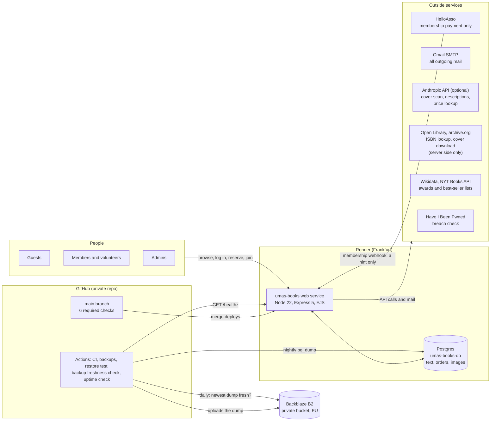

**Two layers of backup.** Render keeps its own seven-day point-in-time recovery
for the database; on top of that a nightly dump (uploaded photos included) goes
to a private Backblaze B2 bucket that Render cannot touch. See §12.

**Preview mode.** While the shop is still being shown to outsiders, setting
`PREVIEW_MODE=true` puts the whole site in "coming soon" mode: a banner on every
page, online reservations and the membership payment widget switched off, and
search engines told to stay away. See §3 and §13.

**Why one app.** Squarespace was retired; the marketing pages are EJS views in
the same Express process as the members area, so there is one deployment, one
login, one database and one thing to monitor.

---

## 2. Technology

| Layer | Choice | Notes |
|---|---|---|
| Runtime | Node.js 22 (`engines: 22.x`) | pinned in `package.json`, `umas-books/.node-version` and CI |
| Web | Express 5 | rejected async handler promises reach the error handler natively |
| Views | EJS, server-rendered | marketing views in `views/marketing/`; English and French via `tr()` (§3) |
| Database | PostgreSQL (Render, `1c-2g`) | `pg` pool; `timestamptz` everywhere |
| Sessions | `express-session` + `connect-pg-simple` | rows in table `session`; 30-day sliding cookie |
| Security middleware | `helmet` (CSP, HSTS), `express-rate-limit`, custom CSRF | |
| Uploads | `multer` (memory) + `sharp` re-encode to JPEG | admin only; bytes stored in the `images` table, served at `/img/<hash>.jpg` |
| Two-step login | TOTP authenticator app (`lib/totp.js`) | required for admins; the secret is encrypted in the database |
| Languages | server-side English and French | `tr()` in views, cookie `umasbooks_lang`; emails follow the reader's stored language (§3) |
| Mail | `nodemailer` over Google Workspace SMTP | one mailbox (`admin@umasbooks.org`) for human and system mail |
| Optional AI | Anthropic API (Claude) | cover scan, book descriptions and genre, market price lookup; every use is optional and off without `ANTHROPIC_API_KEY` |
| Payments | HelloAsso for the membership only (hosted membership form, payment lookups); books and seats are paid in the shop, no payment provider | OAuth client credentials |
| Hosting | Render Blueprint (`render.yaml`) | web `1c-2g`, database `1c-2g`, Frankfurt; migrations run as the pre-deploy command |
| CI/CD | GitHub Actions + Dependabot | six required checks; Render deploys on merge; actions pinned by commit |

---

## 3. Inside the web app

The app lives in [`umas-books/`](../umas-books/). The repo root holds only the
static files the marketing pages load (`assets/`, `logo.png`), `render.yaml`, CI
config and docs.

```mermaid
flowchart TB
  IDX["src/index.js<br/>middleware order, route mounting,<br/>background timers, shutdown"]

  subgraph MW["src/middleware"]
    MA["auth.js<br/>attachUser, requireAuth/Admin/Member/Volunteer"]
    MC["csrf.js<br/>lazy token, constant-time compare"]
    MR["rateLimits.js<br/>per-IP limiters"]
    MI["idParams.js<br/>bad ids give 404"]
    ML["lang.js<br/>English or French per request"]
    MP["lib/preview.js<br/>preview mode: banner, noindex"]
    MS["noStoreForUsers.js<br/>no caching of logged-in pages"]
  end

  subgraph RT["src/routes"]
    direction LR
    PUB["Public<br/>books, events, sessions, blog, contact,<br/>pre-registration + volunteer forms,<br/>book requests, img, seo"]
    MEMB["Members<br/>dashboard, account, privacy, forum,<br/>charity, volunteer, meetings"]
    COM["Commerce<br/>cart and reservations, helloassoWebhook (membership)"]
    AUTH["auth.js, twoFactor.js<br/>signup, verify, login, two-step,<br/>reset, password"]
    ADM["admin/*<br/>members, inventory (scan, move, sell),<br/>pricing, price suggestions, awards (add, remove, re-check), reports,<br/>requests, forum moderation, events, sessions,<br/>meetings, volunteer shifts, blog,<br/>announcements, charity, dashboard, audit"]
  end

  subgraph LIB["src/lib"]
    direction LR
    L1["cart.js<br/>orders, holds, reconcile, late recovery"]
    L2["helloasso.js<br/>API client, 10 s timeouts"]
    L3["membership.js<br/>sync, expiry, backstop"]
    L4["reservations.js<br/>2-week holds, reminders"]
    L5["tz.js, dates.js, calendar.js<br/>Paris time, calendar grids"]
    L6["validation.js, passwordPolicy.js,<br/>resetTokens.js, sanitizeHtml.js"]
    L7["emailVerification.js, passwordReset.js,<br/>errorAlert.js, session.js, env.js"]
    L8["bookLookup.js, coverVision.js,<br/>uploadImage.js, imageStore.js, health.js"]
    L9["totp.js, audit.js, privacy.js,<br/>memberExport.js, lang.js, inventory.js"]
    L10["pricing/*<br/>rules, market lookup, clearance, settings"]
    L11["awards/*<br/>Wikidata, NYT, display"]
    L12["bookRequests.js, reports.js,<br/>forumModeration.js, orderEmail.js"]
    L13["jobGuard.js, imageCleanup.js,<br/>preview.js, errorHandler.js"]
  end

  DBM["src/db.js<br/>pg Pool, withTransaction,<br/>error handler and timeouts"]
  MIG["src/migrate.js + migrations/*.sql<br/>tracked in schema_migrations"]
  VIEWS["views/ (EJS)<br/>marketing/, admin/, partials/"]

  IDX --> MW --> RT
  RT --> LIB --> DBM
  RT --> VIEWS
  MIG --> DBM
```

Conventions that hold across the code:

* **No ORM.** Plain parameterised SQL; the only interpolated pieces are constants.
* **`withTransaction(pool, fn)`** is the only way multi-step writes are done; a
  failing `ROLLBACK` can't mask the original error.
* **Comments explain why**, and reference the incident that caused the code.

**Languages.** Everything guests and members see is available in English and
French; admin screens stay English. A cookie, `umasbooks_lang`, is written by
the EN/FR toggle in the page header. The `lang.js` middleware runs before the
login check and reads only headers (so it never touches the session or the
database): French when the URL starts with `/fr/` (the same public pages have a French address of
their own, so search engines can index them), else when the cookie says `fr`, else the browser's
`Accept-Language`, otherwise English. Views call `tr('English', 'Français')`
and server code calls `req.tr(...)`. This covers the marketing pages too: they
are EJS views whose `data-i18n` hooks the server fills from the French
dictionaries before sending (`lib/pageDictionary.js`), so the legal pages, titles,
meta and Open Graph tags are French in the HTML itself (a small script only
re-applies the same strings after a client-side toggle), with localised dates.
Euro amounts go through one helper, `formatEuro` (`lib/money.js`): `12,50 €` in
French, `€12.50` in English. Emails follow the reader's stored language:
`users.lang` (set at signup, refreshed at login), `orders.lang` (set at
reservation) and `book_requests.lang`; an empty value means English. French mails
carry the same no-break spaces as the pages. A crawler test reads every customer page,
form message and email in French and fails on English left in them (`docs/i18n-audit.md`). Book
descriptions have a French column (`description_fr`). Admin screens, and the
admin-only alert emails, stay English.

**Preview mode.** `lib/preview.js` reads `PREVIEW_MODE` (`true` or `1`) on every
request. When on, views get `res.locals.preview`: a "coming soon" banner is shown
on every customer page, an `X-Robots-Tag: noindex, nofollow` header and a robots
meta tag go out, `robots.txt` turns every crawler away, the sitemap is empty, the cart refuses
to reserve (a friendly notice), the membership page shows a notice instead of the HelloAsso widget, and
the contact form offers a "Feedback on the preview" topic. Admin pages show a
reminder that the mode is on. Unset (the default) means the site behaves
normally.

---

## 4. Request lifecycle

Order matters here — the registration order in `src/index.js` *is* the design.
Static files and uploaded images are served before the session so that they
never cost a session or user lookup, and the HelloAsso webhook is mounted before
CSRF because it is an external POST with no token. The preview-mode flag is set
first of all so that even static files and error pages carry the `noindex`
header when the site is in preview.

```mermaid
flowchart TD
  R([Incoming request]) --> PV["preview mode flag<br/>res.locals.preview, noindex header"]
  PV --> C["compression"]
  C --> S1["Static files<br/>/public, /assets, /logo.png<br/>(7-day cache)"]
  S1 --> IM["GET /img/hash.jpg<br/>photo bytes from the images table,<br/>cached for a year, no cookie"]
  IM --> H["GET /healthz<br/>SELECT 1, 3 s limit, 503 on failure"]
  H --> SEO["robots.txt, sitemap.xml"]
  SEO --> HEL["helmet<br/>CSP, HSTS, no-referrer"]
  HEL --> U["urlencoded body parser"]
  U --> SES["express-session<br/>Postgres store, cookie umasbooks.sid"]
  SES --> REF["session refresh<br/>saved at most once a day"]
  REF --> LG["language<br/>cookie or Accept-Language"]
  LG --> AU["attachUser<br/>re-reads role flags, disabled,<br/>password_changed_at by primary key"]
  AU --> NS["logged-in pages: no-store"]
  NS --> LOC["view locals<br/>user, cart count, lazy CSRF token"]
  LOC --> UP["admin upload mounts<br/>requireAdmin first, then multer"]
  UP --> WH["POST /webhooks/helloasso<br/>rate-limited, before CSRF"]
  WH --> CS["csrfProtection<br/>every other POST"]
  CS --> API["/api/csrf-token, /api/session"]
  API --> MK["marketing pages, legal pages<br/>(MARKETING_PAGES list)"]
  MK --> RM["route modules<br/>auth, two-step, dashboard, account, privacy,<br/>forum, charity, volunteer, meetings, events,<br/>blog, sessions, books, cart, contact,<br/>marketing forms, book requests, admin"]
  RM --> NF["404 page"]
  NF --> ER["error handler<br/>log, alert email, 500 page"]
```

---

## 5. Accounts, sessions and roles

Roles are flags on `users`: `is_admin`, `is_member`, `is_volunteer`, plus
`is_disabled`. They are **re-read from the database on every logged-in request**
by `attachUser`, so disabling someone, demoting an admin, or changing a password
takes effect on their very next request — including on other devices.

```mermaid
stateDiagram-v2
  [*] --> Anonymous
  Anonymous --> Signup: POST /signup
  Signup --> Unverified: neutral notice, same page whether or not the email exists, plus a verification email
  Unverified --> Unverified: no password exists yet, login impossible (resend link offered)
  Unverified --> ChoosePassword: GET /verify-email/:token, first confirmation, sessions killed
  ChoosePassword --> Verified: person picks their own password (reset flow)
  Verified --> LoggedIn: login
  Verified --> TwoStep: password right, two-step switched on
  TwoStep --> LoggedIn: authenticator code or one-time recovery code
  TwoStep --> Anonymous: 5 minutes pass or too many wrong codes
  LoggedIn --> LoggedIn: attachUser re-checks the row every request
  LoggedIn --> Anonymous: logout, disabled, deleted, or password changed elsewhere
  Anonymous --> Reset: POST /forgot-password (neutral reply)
  Reset --> Verified: reset link used once; also verifies the email and clears the lockout
  note right of ChoosePassword: A self-signup account never has a session before its inbox owner acts, and the password typed at signup is useless once they do
```

Key rules:

* **Passwords** — bcrypt cost 12, minimum policy plus a Have-I-Been-Pwned
  k-anonymity breach check; a locked account (5 failures, 15 min) answers like a
  wrong password; the lockout counter is one atomic `UPDATE`. Wrong two-step
  codes count toward the same lockout.
* **Reserving and joining need an account.** Guests browse and fill the cart
  (session); `POST /cart/reserve` (and the old `GET /cart/checkout`, which only
  redirects) send them to `/login?returnTo=/cart` (preview mode is checked
  first, so its notice is never masked), and the reservation is placed under the
  account's confirmed email with `orders.user_id`. The
  `returnTo` (local paths only, `lib/returnTo.js`) also rides inside the
  single-use email-verification and reset tokens (`return_to` columns), so
  signup -> confirm -> choose password -> login ends on the cart, and the cart
  itself is copied across the login's session regeneration.
* **Sessions** — id regenerated at login (the guest cart is carried over); the session is **saved before the
  redirect** (`lib/session.js`) because `express-session` otherwise answers
  before its write lands; cookie `HttpOnly`, `Secure`, `SameSite=Lax`.
* **Two-step verification (TOTP).** Any authenticator app works. It is
  **mandatory for admins** and optional for everyone else: `requireAdmin` sends an
  admin who has not enrolled to `/account/2fa` and nothing else works until they
  do. At login the password only opens a five-minute "pending" step; the 6-digit
  code (or a one-time recovery code, ten are issued at setup) completes the
  login. A code cannot be replayed, and enrolling needs the account password
  again. The secret is stored encrypted (AES-256-GCM) with the key
  `TOTP_ENCRYPTION_KEY`, so a database copy alone does not reveal it. An admin
  who loses their phone and codes is reset by another admin (**Reset Two-Step**
  on the Members page, written to the audit log); non-admins can switch it off
  themselves, admins cannot.
* **Pre-hijack defence.** Someone could sign up with a victim's email and a
  password they know, then wait for the victim to confirm the address. So
  **signup asks for no password**: the account (`users.first_verification_pending`,
  migration 055) starts with an unusable random hash and cannot log in. The
  emailed link ("confirm your email and choose your password") verifies the
  address, bumps `password_changed_at` (every session dies), stores a fresh
  unusable hash and redirects to the reset-password page with a single-use
  token ("Email confirmed: now choose your password"), where the password
  policy and breach check apply. Only the mailbox owner can set a password.
  Membership matching runs after that choice. After choosing, the person lands
  on the login page. `POST /resend-verification` (neutral, 6 per 15 min per IP,
  one mail per account per 5 min) replaces a lost link; Forgot password also
  works. Accounts that signed up with a password before this change and are
  still unconfirmed follow the same rules. Admin-created, grandfathered and
  admin-email-changed accounts are not flagged and behave as before.
* **Email verification gates identity-sensitive features**: order history on
  `/account` and automatic membership attribution both require
  `email_verified_at`. Accounts created by an admin are verified immediately
  (the invite link proves the mailbox); existing accounts at migration 032 were
  grandfathered as verified.
* **CSRF** — a per-session token created lazily, compared in constant time;
  `/api/csrf-token` saves the session before answering.
* **Real client IP.** Production is visitor, Render's edge (Render's edge is
  Cloudflare-based, hence the `cloudflare` response header; the association has no
  Cloudflare account of its own and DNS at Squarespace Domains points straight at
  Render, an `A` record to `216.24.57.1`), Render's internal proxy, app: two
  trusted hops. `trust proxy` is set to the number
  `TRUST_PROXY_HOPS` (`lib/trustProxy.js`; default 2 in production, 1 elsewhere
  and in tests), so `req.ip` is the real visitor and every user of `req.ip`
  (rate-limit key `ipKey`, the admin audit log, the webhook
  limiter) follows. With one hop only the shared edge address was seen: one rate
  limit bucket for everybody. The admin page `/admin/diagnostics/client-ip`
  (English, admin only) shows what the app sees for your own request.
* **Launch guards** (`lib/env.js`, `validateEnv().alerts`): with preview off the
  boot warns, and sends one alert email per boot, when `APP_BASE_URL` is missing
  or not https, when `HELLOASSO_API_BASE` is the sandbox, or when the HelloAsso
  credentials are missing; a missing `CONTACT_TO` only warns. Nothing crashes the
  site. A sandbox setup also puts a red banner on every admin page. On a live site
  `lib/baseUrl.js` never falls back to `RENDER_EXTERNAL_URL`, and
  `middleware/canonicalHost.js` 301-redirects GET/HEAD requests for any Host other
  than `APP_BASE_URL`'s (never `/healthz`, never POST or webhooks).
* **Confirmation link.** `GET /verify-email/:token` only shows a "Confirm my
  email" button and consumes nothing (mail scanners prefetch links); the button
  POSTs (CSRF protected) and does the work. One unusable password hash is
  computed at startup, not per request, and both verbs share a 30 per 15 min per
  IP limiter.
* **Unconfirmed accounts** (self-signup, never confirmed) are deleted after 7
  days by the daily purge, only when they hold no data.
* **Orders follow the account.** Export, erasure and "My account" match orders
  by `user_id`, and by email only for old orders that have no account; an admin
  email change links such old orders to the account first. After an erasure the
  membership payment stays, detached; the membership sync re-attaches it when the
  same person registers again.
* **Rate limits** are in memory (reset on restart) and mostly per IP: login 20
  failures / 15 min, sign-up 30/h, password reset requests 10 / 15 min, reserve 10/h, cart edits 60 / 15 min, event sign-up 10/h,
  forum posts 10/h and replies 30/h, charity ideas 10/h, contact, pre-registration and volunteer forms 5 / 15 min each,
  webhook 300 / 5 min, book requests 5/day, "find my requests" 5/h (plus 3 a day
  per address). A few are per account instead: wrong two-step codes,
  wrong current password (password change, download or delete of your own data),
  forum reports, and admin price checks (30 a minute, since one can cost an AI
  call). See `src/middleware/rateLimits.js` and the route files.

---

## 6. Data model

37 application tables (plus `schema_migrations` and the session table), grouped by what they belong to. Foreign keys below are the real
ones from `migrations/`. (`event_rsvps` is unused; `wishlist_requests` was dropped
in migration 029.)

```mermaid
erDiagram
  users ||--o{ email_verification_tokens : "proves mailbox"
  users ||--o{ totp_recovery_codes : "one-time codes"
  users ||--o{ password_reset_tokens : "resets"
  users ||--o{ membership_payments : "HelloAsso payments"
  users ||--o{ forum_threads : writes
  forum_threads ||--o{ forum_replies : has
  users ||--o{ forum_replies : writes
  users ||--o{ favorites : saves
  books ||--o{ favorites : "is saved as"

  books ||--o{ book_copies : "physical copies"
  books ||--o{ book_awards : "awards, best-seller lists"
  users ||--o{ book_awards : "decided by"
  book_copies ||--o{ shop_sales : "sold over the counter"
  users ||--o{ shop_sales : "sold by"
  users ||--o{ book_requests : "may link"
  book_copies ||--o{ book_requests : "matched copy"
  orders ||--o{ book_copies : "holds in cart"
  orders ||--o{ order_items : contains
  book_copies ||--o{ order_items : "sold as"
  classes ||--o{ class_dropin_seats : "paid seats"
  orders ||--o{ class_dropin_seats : holds
  class_dropin_seats ||--o{ order_items : "sold as"

  events ||--o{ event_signups : "public sign-ups"
  classes ||--o{ class_signups : "pre-registration"
  events ||--o{ announcements : "linked from"
  users ||--o{ blog_posts : writes

  volunteer_shifts ||--o{ volunteer_signups : "slots"
  users ||--o{ volunteer_signups : books
  meetings ||--o{ meeting_rsvps : "RSVPs"
  users ||--o{ meeting_rsvps : answers

  charity_rounds ||--o{ charity_options : offers
  charities ||--o{ charity_options : "appears as"
  charity_options ||--o{ charity_votes : "receives"
  users ||--o{ charity_votes : casts
  charities ||--o{ charity_ideas : "approved from"
  users ||--o{ charity_ideas : suggests
```

| Domain | Tables | Notes |
|---|---|---|
| Accounts | `users`, `email_verification_tokens`, `password_reset_tokens`, `totp_recovery_codes`, `session`, `schema_migrations` | tokens and recovery codes stored as hashes; `users` also holds `lang`, the encrypted two-step secret and `inactivity_warned_at`; `session` is created by the store |
| Shop | `books`, `book_copies`, `orders`, `order_items`, `class_dropin_seats`, `shop_sales` | an order line is *either* a copy *or* a seat (CHECK constraint); copy status `in_stock / reserved / in_cart / sold / donated / damaged` (`reserved` also covers a copy held by an online reservation, with `cart_order_id` pointing at its order; `in_cart` is a leftover of the old online checkout and nothing sets it any more); one row per ISBN (unique index); `shop_sales` is the over-the-counter equivalent of a collected reservation line |
| Awards | `book_awards` | awards, shortlists and best-seller lists per book, with `source` (`wikidata / nyt / manual`); every row is `status = verified` and shown |
| Pricing | `pricing_settings`, `price_lookups` | one settings row (`id = 1`) holding every number the rules use; one cached market lookup per ISBN-13 |
| Book requests | `book_requests`, `book_request_list_tokens` | customer "ask us for a book" requests, identified by an emailed link instead of an account; personal columns are cleared when a request ends |
| Images | `images` | content-addressed: id is the SHA-256 of the bytes; `books.cover_url` and the announcement, charity and blog image columns hold only the short `/img/<hash>.jpg` URL. Book covers from Open Library / archive.org are downloaded once by the server (`lib/coverStore.js`), re-encoded and stored here; `books.cover_source_url` and `cover_fetch_*` only drive the download retries (migration 059) |
| Admin | `admin_audit_log` | who, what, numeric target id, time and IP; no member emails or names; purged after 12 months |
| Membership | `membership_payments` | one row per HelloAsso membership order (the only online payment); drives `member_expires_at` |
| Programs and events | `events`, `event_signups`, `classes`, `class_signups` | a `classes` row is a program session; `dropin_price` set = bookable |
| Community | `forum_threads`, `forum_replies`, `announcements`, `blog_posts`, `favorites` | rich text goes through `sanitize-html`; threads and replies carry `hidden_at / hidden_reason / hidden_by` for moderation |
| Volunteering | `volunteer_shifts`, `volunteer_signups`, `meetings`, `meeting_rsvps` | |
| Charity vote | `charity_rounds`, `charity_options`, `charity_votes`, `charities`, `charity_ideas` | a library of charities reused across rounds |

Details of the shop tables worth knowing:

* **Condition grades and binding.** `book_copies.condition` is one of five
  grades, `new`, `like_new`, `very_good` (the default), `good` or `acceptable` (migration 078 turned `like_new` into `very_good`; migration 083 made `like_new` a grade again, converting no rows back),
  enforced by a CHECK constraint (migration 048 remapped the old values; a copy
  that cannot be sold at all has status `damaged`, not a condition).
  `books.binding` is `hardcover` (shown as "Hardback"), `trade`, `mass_market` or `other`, listed as Mass Market, Trade, Hardback, Other (optional; older
  books are NULL until filled in; migration 077 renamed `paperback` to `trade`). Both are shown in English and French.
* **Copy source.** `book_copies.source` records where a copy came from:
  `donation`, `purchase`, `lot` (job lot) or `other`; NULL means unknown (every
  copy added before migration 045). The Reports pages group by it.
* **Price history for the learning loop.** Each copy also stores
  `suggested_price`, `suggested_level`, `price_basis` (`suggested`, `adjusted` or
  `manual`) and `is_clearance`, so that later the shop can see how often a
  volunteer kept the suggested price (see "Pricing" below). The data is collected but nothing
  reads it back yet.
* **Alphabetical order.** Lists sorted by title use `books.title_sort` (migration 086, a generated
  column), which ignores a leading whole-word "The" (not "A"/"An" or French articles); the shown title
  is unchanged. See `umas-books/ARCHITECTURE.md`.
* **Inventory locations.** `book_copies.location` is free text per physical copy
  (trimmed, capitals kept as typed; "Store" and "STORE" are the same place when
  matching and listing); there is no locations table, the drop-down is simply the
  distinct values already used, one per case-insensitive name. The admin **Move books** page moves one copy per
  scanned ISBN and writes each move to the audit log.
* **Fixed price for new books (loi Lang).** A copy whose condition is `new` must
  carry `publisher_price` and be priced between 95% and 100% of it, checked on
  the server when a copy is added or edited. Used copies are free-priced.
* **Refund and pickup columns (migration 060).** `orders.refunded_at`, `refund_note`,
  `collected_at`, `collected_by` (user, `ON DELETE SET NULL`),
  `customer_pickup_reminder_sent_at`, `pickup_reminder_sent_at`; see §7. Refunded
  orders are accounting records: they are kept like paid ones (10 years) and
  anonymised only when the account is erased. The columns of the old online
  checkout (`refund_detected_at`, `refund_alert_sent_at`, `checkout_redirect_url`,
  `checkout_intent_id`, `helloasso_order_id`) stay on old rows; nothing writes
  them any more.
* **Reservation columns (migration 066).** `orders.reserved_until` (the
  deadline), `reservation_extended_at` (the one allowed extension),
  `released_at` + `release_reason` (`customer`, `admin`, `expired`, `no_show`,
  `account_erased`), `expiry_notice_sent_at`, the payment taken in the shop
  (`payment_method`, `amount_received`, `payment_note`, `reserved_total`),
  `split_from_order_id` (a partial pickup) and
  `class_dropin_seats.reminder_sent_at`. `orders.status` is plain text:
  `reserved`, `paid`, `refunded`, `expired`, `cancelled` and the legacy `pending`.
* **Order extras.** `orders.withdrawal_waiver_at` is only set on old orders (the
  drop-in tick-box of the old online checkout; there is no waiver step now);
  `orders.cgv_accepted_at` / `orders.cgv_version` record when the buyer accepted
  the terms of sale and which version (`TERMS_OF_SALE_VERSION` in
  `src/lib/legal.js`, bump it when the terms page changes); they are in the
  member data export and survive anonymisation;
  `orders.client_ip` is no longer written (the code sets it to NULL; the daily
  purge still clears old values); `orders.lang` sets the language of the
  confirmation email.

### Pricing: suggested prices for used books

When a volunteer adds a copy (or presses *Suggest* on an existing one),
`src/lib/pricing/` proposes a price. It is only ever a **suggestion**: nothing is
saved or published until the volunteer accepts or changes it. The copy's
condition never changes the price; it only marks a `new` book.

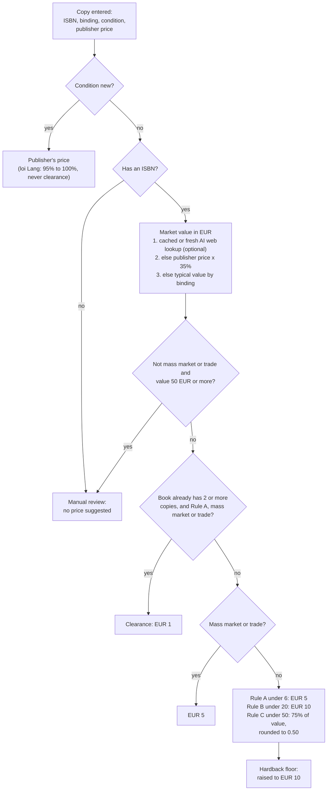

* **Rules are pure functions** (`pricing/rules.js`, no network or database), so
  they always answer instantly and are fully unit-tested. First match wins, as in
  the diagram; the thresholds shown are the defaults.
* **All the numbers live in one database row** (`pricing_settings`, `id = 1`),
  edited by admins on `/admin/pricing`: the standard price levels (3, 5, 10
  EUR; EUR 8 was retired), the mass-market and trade prices (each a flat EUR 5), the hardback floor (EUR 10, optionally
  applied to clearance too), the Rule A/B/C limits, the clearance count, price and
  scope, the rounding step, fallback values by binding and the USD and GBP rates.
* **Clearance** applies when the shop already holds two or more copies of a book
  (in stock or reserved); the next copies (or, by setting, all of them) go to
  EUR 1, by default only for Rule A and mass-market books. It is
  sticky: `book_copies.is_clearance` only changes when a volunteer changes that
  copy's price. `/admin/pricing/review` is a price check of the whole stock that
  shows what would change and applies clearance only on confirmation.
* **Market lookups** (`pricing/market.js`) are the optional AI step: Claude with
  web search, switched on by `PRICING_AI=true` plus `ANTHROPIC_API_KEY`, capped
  per day by `PRICING_AI_DAILY_MAX` (default 150) and cached per ISBN-13 in
  `price_lookups` (a successful lookup for 30 days, an empty one for 7, a failed
  one for an hour). Without it the rules still work from the publisher price or the
  binding fallback, and the admin price-check endpoint is rate-limited because
  one call can cost an AI request.
* **Learning loop (data only).** `suggested_price`, `suggested_level` and
  `price_basis` record what was suggested and whether it was kept; no report
  reads them yet.

### Awards and best-seller lists

Each book page can show prizes and best-seller lists. `src/lib/awards/` looks
them up in order of trust and stores them in `book_awards`.

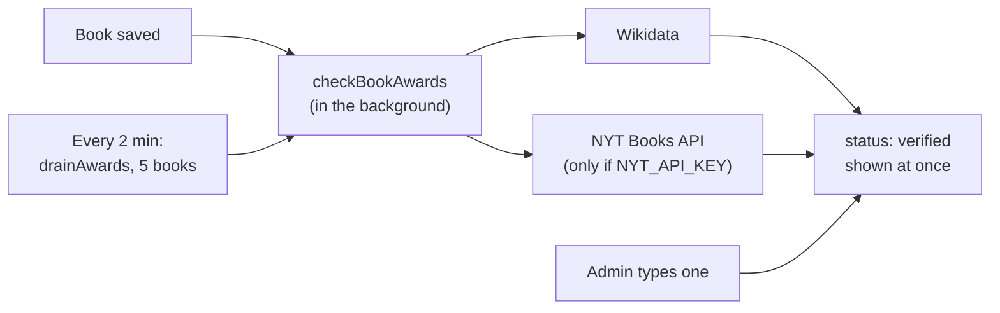

There is no review step and no AI source: customers see exactly what is stored.
The background drain takes never-checked books newest first, then retries errors
after a day, then refreshes books last checked over a year ago; it does not run
at boot, so a restart never hammers Wikidata. `AWARDS_LOOKUPS=off` stops every
lookup (the tests use it so no test reaches the network).

### Customer book requests

"Can't find a book? Ask us" (`/request-a-book`) needs no login or membership. The
requester is identified by an email address confirmed with a link (double
opt-in); every email link carries a random token that is stored only as a hash.

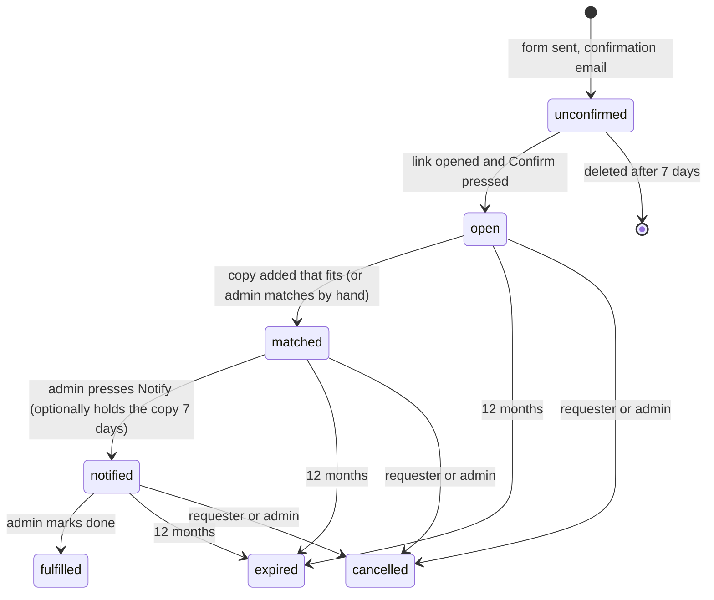

* **Matching on intake.** When a copy is added, or a book edited, open requests
  for the same ISBN (10 or 13 form) or the same normalised title with a
  compatible author become `matched` to that copy.
* **Hold.** *Notify and hold* reserves the copy for the requester for 7 days using
  the ordinary reservation machinery (§9), so it expires and shows as reserved like
  any other reservation.
* **Self-service.** Each request has a private manage link (`/my-requests/:token`)
  to cancel it; "find my requests" emails a 30-day link listing every request of
  one address (`book_request_list_tokens`), and a logged-in member can cancel from
  their account. Limits: 3 pending requests per email, 5 submissions a day per IP.
* **Privacy.** Email, name, note and account link are cleared when a request
  ends (cancelled, expired, or closed 30 days); only title, author and ISBN stay
  for anonymous demand counts. Erasing a member cancels and strips their requests
  (`lib/privacy.js`).

### Curated collections

Hand-picked themed shelves (*Paris Is Always a Good Idea* ...) shown as a row of
round-picture buttons on Browse Books and as pages of their own. Tables
`curated_collections` (slug, English and French title and description, the AI
guidance prompt, picture, sort order, `published`, `last_generated_at`) and
`curated_collection_books` (collection, book, status `suggested` / `approved` /
`rejected`, reason, position). Migration 091 seeds 19 collections, all unpublished.

* **The review step is mandatory.** The AI only writes `suggested` rows
  (`lib/collectionSuggestions.js`). Customers see a collection only when
  `published`, and in it only `approved` books with a copy `in_stock` at render
  time (`lib/collections.js`; a sold or reserved book drops off by itself).
  Publishing needs one approved book and the French title and description.
* **Generate** reaches the paid API through the same client as the book
  descriptions (`claudeRequest` in `lib/bookDescription.js`): the shared daily cap,
  the usage counts, the credit alert, and a friendly message instead of an error.
  Candidates are the in-stock books not yet in the collection, cut to the 300 best
  keyword matches, sent in batches of 100; answers are parsed as JSON, ids not in the
  list are dropped, and each id is re-checked in the database before the insert
  (`ON CONFLICT DO NOTHING`, so earlier decisions are never touched).
* **Pages.** `routes/collections.js` serves `/collections/:slug` and `/fr/collections/:slug`
  (`lib/frUrls.js` knows the pattern), unpublished or unknown is a 404; the sitemap lists
  published collections with a book, at both addresses. The Browse carousel (heading above, under the search bar) is
  `views/marketing/partials/collections_row.ejs`, shown on the plain view only
  (`public/page-books.js` hides it with a genre, search, topic or `?new=1`).
* **Admin** (English only): `routes/admin/collections.js`, `/admin/collections`.
  `clear-test-data` keeps the collections and clears only their book lists.

### Reports, copy source and in-shop sales

* **Reports** (`/admin/reports`, `lib/reports.js`) are read-only and made of a few
  aggregate queries each, never one query per book. Seven reports: *Inventory on
  hand* (by genre, condition, location and source), *Aging stock*, *Sales over
  time* (online plus in-shop by day, week, month or year, drop-in seats shown
  apart), *Sell-through by genre*, *Membership*, *Intake log* and *Accounts* (everyone with an account by type; same type definitions as the admin accounts list, `lib/accountTypes.js`). Date ranges
  are Paris calendar days. Any table can be downloaded as CSV; no report except *Accounts* shows
  email addresses or buyer names, and every CSV download is written to the audit
  log (report name only).
* **Sell in shop** (`/admin/inventory/sell`) is **retired**: sales are made at the Till
  (`/admin/till`, see "The till"). GET and POST on the old URL redirect (302) to
  `/admin/till?notice=sell-retired`, which shows "Sales are made at the Till now". The
  `shop_sales` table and its old rows stay (the till writes one `shop_sales` row per book it
  sells, and the reports and the accounting export read them).
* **Move books** (`/admin/inventory/move`) is described under inventory
  locations above.

### Forum moderation

An admin can hide a thread or reply from the forum page with a reason (illegal
content, harassment, spam or other) and an optional note. The text stays in the
row (so it can be reviewed and restored); members see a placeholder. Hiding sends
the author a **statement of reasons** by email in their language, as the EU
Digital Services Act requires, with `admin@umasbooks.org` as the contact for
contesting it. Hide and restore are audit-logged with the kind and reason code
only, never the post text or the note.

**Migrations** (`src/migrate.js`, files `migrations/001` to `054`; numbers 049,
051 and 052 were never used) are run by Render's **pre-deploy command**,
`npm run migrate`, before a new version takes traffic (§11), not by the web
process at boot. Each file applies exactly once: a `schema_migrations` table, a
per-file transaction and an advisory lock, so running it twice is harmless. A
pre-existing database is baselined, not re-migrated. If a migration fails the
deploy is aborted and the old version keeps serving. Never edit a deployed
migration — add a new numbered file.

---

## 7. Reservations and payment in the shop

Principle: **nothing is paid on the website for books and drop-in seats.** An
account holder *reserves*; the shop holds the items; the customer pays in person
(at the shop when collecting books, at the session for a drop-in seat), and
staff record the payment. The only online payment left is the membership (§8),
where the webhook body is still never trusted.

```mermaid
sequenceDiagram
  autonumber
  actor B as Customer (account holder)
  participant W as Web app
  participant DB as Postgres
  participant GM as Gmail
  actor S as Shop staff

  B->>W: POST /cart/reserve, logged in (name, terms ticked;<br/>email comes from the account)
  W->>DB: one transaction (per-account advisory lock): check limits,<br/>create order status reserved with reserved_until,<br/>lock copies (reserved) and seats (reserved),<br/>queue the confirmation in email_outbox
  W->>GM: send the queued confirmation at once (best effort);<br/>the outbox worker retries if Gmail refuses
  W-->>B: redirect to /cart/return?order=token (the reservation page)
  Note over W,DB: every 6 h, and on page reads: reminders,<br/>release of reservations past their deadline
  B->>S: comes to the shop, pays (cash, card or cheque)
  S->>W: POST /admin/orders/:id/collect (method, amount)
  W->>DB: one transaction: order paid and collected (paid_at = now),<br/>copies sold, seats sold
```

What keeps it correct:

| Concern | Mechanism |
|---|---|
| Overselling | atomic `UPDATE … WHERE status='in_stock'` on the copies inside the reservation transaction (a mismatch rolls everything back as `SOLD_OUT`), copy rows locked in id order, class rows locked with `FOR UPDATE` and the seat count re-read |
| Hoarding stock without paying | per account: at most `MAX_RESERVED_COPIES` (10) books and `MAX_ACTIVE_RESERVATIONS` (3) open reservations (`lib/legal.js`), checked under a per-account advisory lock so two simultaneous requests cannot slip past; a cart holds at most 20 lines; `POST /cart/reserve` is rate limited (10 an hour per address) |
| Anonymous reservations | reserving requires a logged-in account with a confirmed email, enforced on the server (`routes/cart.js`); the order stores `user_id` and the account's email (a posted email is ignored). Guests keep a cart in their session but cannot reserve |
| Terms | reserving requires accepting the terms of sale; the order stores the time and the version (`cgv_accepted_at`, `cgv_version`). There is no withdrawal waiver step: nothing is paid online |
| Deadline | `orders.reserved_until` = the end of the 14th Paris day for books (`RESERVATION_DAYS`); for a seat-only order, the end of its session; an admin can extend a books reservation once by 7 days (`extendReservation`) |
| Release | `lib/reservations.js` `expireOrderReservations` / `releaseEndedSeats` run at the top of every route that shows copy status and from the 6-hourly jobs, so a lapsed reservation is released even when the site was idle: the copies go back `in_stock`, the seats `released`, the order `expired` (`release_reason`) |
| Customer cancel | `cancelReservationAsCustomer`: owner-only (another account gets the same "not found"), books at any time, seats until `SEAT_CANCEL_HOURS` (24) before the session; the release is one transaction with the order row locked |
| Gmail down at reservation time | the confirmation is **stored first** (`email_outbox`, same transaction as the reservation), sent at once, and retried by the worker with backoff (below). A failure while *building* the confirmation never undoes a reservation (savepoint); *Resend confirmation* sits on the orders list |
| Customer without the email | `/cart/return?order=<token>` and the account page show the reservation (what, deadline, how to cancel) |
| Drop-in seat rows | marked `released`, never deleted (`order_items` references them); capacity ignores released seats |
| Selling a reserved copy another way | the admin inventory (sell, release, status edits) refuses a copy reserved by an online order and names the order: it is collected or cancelled from its order page |
| Leftovers of the old online checkout | `lib/cart.js` `runCartMaintenance` (every 10 min) only cleans up copies still `in_cart` from before the change; no payment provider is asked |

### Collecting, payment records, refunds and reminders

The site cannot move money. Staff take the payment in person, then record it
(`lib/orderActions.js`, `/admin/orders/:id`). Status values of `orders.status`
(plain text, no constraint): `reserved`, `paid`, `refunded`, `expired`,
`cancelled`, and `pending` (only on old online-checkout orders).

| Concern | Mechanism |
|---|---|
| Mark collected and paid | `collectReservation`: one transaction with the order row locked: `reserved` -> `paid` with `paid_at`, `collected_at` / `collected_by`, `payment_method` (cash / card at the shop / cheque / other), `amount_received` (it can only be **lowered** from the held total, with a note; `reserved_total` keeps the original), the held copies become `sold`, the held seats `sold`; items no longer held are dropped. Written to the admin audit log |
| Partial pickup | "Collect selected items": the chosen items are sold and paid on this order; the rest moves to a **new** reserved order with the same deadline (`split_from_order_id` points back) |
| Cancel, no-show, extend | "Cancel reservation" (`release_reason` admin) and "Mark no-show / expired" (`no_show`, status `expired`) release the items; "Extend by 7 days" works once and only while books are held |
| Mark refunded | one transaction with the order row locked: `paid` -> `refunded` (+ `refunded_at`, required `refund_note`); the copies this order sold go back `in_stock`, except a copy sold again since, which is left alone and named in the audit entry; its drop-in seats become `released`. Refuses any order that is not `paid`; a second call changes nothing. The refund itself (cash, cheque, card) is done in the shop; the admin page has a confirmation step (warning, tick box, note) and the customer is not emailed |
| Money in the figures | revenue counts `status = 'paid'` at **`paid_at`**, the day staff record the payment (not the day of the reservation), in Europe/Paris (`lib/dashboardStats.js`); reserved, expired and cancelled orders never count; refunded ones drop out and appear in a **Refunds** table. The **Reservations** report (`/admin/reports/reservations`, CSV) shows reserved / collected / expired / cancelled per month and the conversion rate |
| Customer emails | all through the outbox, in the order's language: reservation e-mail (not a proof of purchase: deadline, shop address and hours, how to cancel, no-returns notice, legal guarantees, mediator, terms version accepted; no withdrawal notice or form), reminder on day 10 (`RESERVATION_REMINDER_DAYS_BEFORE` = 4 days before the deadline), "your reservation has ended" (no penalty), a reminder 24 hours before a reserved drop-in seat. Each is claimed in the database first (a `*_sent_at` column) and sent once |
| Admin digest | one email listing the reservations expiring within 2 days (once per order). The dashboard "Needs attention" box counts reservations expiring within 3 days, those past the deadline and not yet released, and the old-checkout leftovers |
| Admin view | `/admin/orders` opens on **Reserved: awaiting pickup**; filters (status, expiring in 3 days, expired, past the deadline, old-checkout leftovers), Paris date range, search by number, email or name, 50 per page; `/admin/orders/pickup-list` (and `?print=1`) lists open reservations by customer with shelf locations and the amount to collect; `/admin/orders/:id` shows items, buyer, payment, terms acceptance and history |
| Preview mode | `POST /cart/reserve` is refused with a friendly notice before anything is validated or locked |

### The email outbox

Every customer email (order confirmation, signup/confirm/reset links,
book-request and reservation mails, forum notices, inactivity warnings, the
contact form to the shop) goes through `lib/outbox.js`: **store, then send**.

- `enqueueEmail(db, msg)` inserts a row in `email_outbox`; `db` may be a
  transaction client so the row commits or rolls back with the caller's work.
- `sendEmail(msg)` = enqueue + an immediate send (waits at most 5 s), so mail is
  still instant when Gmail works. It never throws on a send failure, only if the
  row cannot be stored.
- A row is **claimed** by pushing `next_try_at` 5 minutes ahead in one `UPDATE`,
  so the fast path, the worker and two app instances never send the same row.
- Worker (`processOutbox`, every 60 s, `guardJob`, batch of 20; holds no database connection while sending, and is safe on several instances because the claim above is a single `UPDATE ... FOR UPDATE SKIP LOCKED`; a worker that dies leaves its rows `pending` and they are claimed again when the 5-minute lease ends):
  retries due rows with backoff **1, 5, 15, 60, 240 min** (240 repeating) up to
  **8 attempts**, then `status = 'failed'` and **one alert email per hour**
  ("N emails could not be sent": kinds, counts, last error with emails and long
  numbers removed). A row that has waited **over 60 minutes** (pending or
  retrying) raises one **"stuck in the outbox" alert per 6 hours**, counts per
  kind only (the backoff takes 801 minutes to reach `failed`, which used to be a
  long silence). Three failures in a row stop the batch (Gmail is refusing
  everything). Alerts themselves go straight through the mailer with one retry
  (`sendAdminAlert`), because the outbox cannot report its own outage.
- `orders.confirmation_sent_at` is set when a confirmation really went out.
- Admin (English): `/admin/email-outbox` (last 100 rows, retry now, mark failed
  as handled), *Resend confirmation* in the orders list
  (`POST /admin/orders/:id/resend-confirmation`, `routes/admin/emailOutbox.js`),
  and a "Needs attention" box on the dashboard.
- Retention: recipient/subject/body of **sent** rows are erased after 30 days,
  of failed/handled rows after 90 (`RETENTION.outboxSentDays/outboxFailedDays`,
  step `emailOutbox`); one-time-link mails lose their body as soon as they are
  sent, **when they fail**, and when their link lifetime passes while still
  pending (reset 1 h, confirmation 24 h: status `expired`, never retried), so a
  link never sits in a database dump; erasing an account erases its rows, and so
  does erasing an address (rows are matched on `to_email` and on `subject_email`,
  the submitter's address on form mail, migration 068).
- **Per-recipient throttle** (`THROTTLED_KINDS`: verification, signup_attempt,
  password_reset, book_request_confirm, book_request_list): at most 1 mail per
  (recipient, kind) per 10 minutes, 5 per recipient per day, and a shop-wide
  ceiling per kind per hour (`THROTTLE` constants; `MAIL_GLOBAL_PER_HOUR`
  overrides, used by tests). A throttled request stores nothing and logs a
  counter (`getThrottleCounts`, no address); the web response stays neutral.
  Resend buttons and the two book-request mails (a person may ask for 3 books in a row) pass `throttle: "skipInterval"` (the 10-minute rule is skipped, the daily and hourly caps stay), admin actions
  `"off"`; order and reservation mail is never throttled. The goodbye email on self-deletion
  is the one mail that bypasses the outbox (the address is erased right after).

---

### The till

In-person sales, written for a non-developer who runs a physical till. Sales are
in person only: online payment exists only for HelloAsso memberships and orders.

- **Copy codes.** Every copy can be found at the till by the code `UB-<copyId>`.
  There is no label printing in the site (the labels and price sticker pages were
  removed), so a book without an ISBN is sold by typing its `UB-` code.
- **Scan order** (`lookupScan` in `src/lib/till.js`): `UB-<id>` copy code, then
  an exact quick-item barcode, then `ORDER-<n>` (a reservation to collect, or the label of a
  reserved book: `src/lib/tillReservations.js`, paid through
  `collectReservationTx` in the till's own transaction), then an ISBN (10/13, `isbnVariants`), then
  unknown. Only `in_stock` copies are sold as plain books (a copy reserved by an order
  is collected through its order: sold, in-cart and withdrawn copies are
  refused with the reason).
- **Data model** (migration `065_till.sql`): `till_sales` (one payment method per
  sale, `sale_token` unique for idempotency, `status` completed/voided),
  `till_sale_items` (kind book/manual/quick, copy or quick item, quantity,
  `unit_price_cents`, category, original price and reason when overridden),
  `till_quick_items` (name, price, category, active, order, optional stock,
  optional unique-among-active barcode), `till_days` (opening float, counted cash,
  expected, difference, closer, note: the row with `closed_at` locks voids),
  plus `shop_sales.till_sale_id` and `book_copies.sold_at/sold_via`.
- **Sale record.** One transaction: insert the sale (token conflict = the earlier
  sale is returned), lock the copies and quick items `FOR UPDATE` in id order,
  re-check status, price rules (used: any price, audited when changed; new books:
  loi Lang 95-100% via `resolveCopyPricing`), compute the total in cents, cash
  change or card confirmation, then write `till_sale_items`, one `shop_sales` row
  per book copy (so the existing reports count a till sale exactly once) and mark
  the copies sold. A void restocks copies and quick-item stock and deletes that
  sale's `shop_sales` rows, so reports do not count it; the `till_sales` row stays
  as `voided`.
- **Card.** `src/lib/cardPayments.js` defines `startCharge(amountCents, saleToken)`
  and ships `ManualCard` (a person charges the SumUp Solo and presses Card paid).
  A SumUp Cloud API implementation is NOT written (see `docs/till-todos.md`).
- **Day and money.** Days are Paris days. Expected cash = opening float + cash
  sales (completed). Closing stores counted/expected/difference and locks voids
  for that day. The Accounting export (`src/lib/accounting.js`) combines till
  items, older "Sell in shop" sales (no till sale), collected reservations and
  membership payments into rows by day, category and payment method. A
  reservation collected at the till is counted once, from its till lines
  (`reservation_order_id`); one collected with the admin button is counted from the
  order under `orders.payment_method` (cash, card, cheque, other); only old
  online-checkout orders (no method) and memberships are HelloAsso. A refund row
  uses the method of the sale.

#### Till correctness and money safety (migration `074_till_correctness.sql`)

- **The amount shown is the amount recorded.** Every confirm carries
  `expectedTotalCents` and each line's `expected` unit price. After re-pricing from the
  database, `checkExpected` refuses a difference with **409 `price_changed`** (new total in the
  answer) and nothing is recorded; for a card sale the page tells the cashier to cancel the
  charge on the reader and restart. A confirm without an expected total is a 422.
- **`POST /admin/till/check`** runs the same line building and validation as the sale
  (`checkSale`, a read-only transaction, no locks, nothing written). The Cash and Card screens call
  it when they open, so a refusal shows before the customer pays. After "Card paid" the page
  freezes the charged total (kept in `sessionStorage`), and a failure shows the red "already
  charged, do not charge again" box with Record card sale (check first) and Record anyway (same
  token, same total, no check). The till routes always answer JSON (`jsonRoute`): a refusal has its
  message, an unexpected failure is a JSON 500 with `serverError`, so the page can tell a server
  rejection from a network failure (only the latter says "Connection problem", and only that one
  is safe to retry blindly, because of the sale token).
- **Replay.** `till_sales.basket_hash` (sha256 of the payment method and the lines as sent) is
  stored with the unique sale token: the same token with another basket is a 409
  `token_replay`, the same basket returns the first sale.
- **Closed day.** A sale on a Paris day with `till_days.closed_at` is refused (409 `day_closed`)
  unless an admin ticks "Reopen this day to record this sale" with a reason: the day is reopened
  (`closed_at` and the counted figures cleared, `reopened_at/by`, `reopen_reason`) in the same
  transaction as the sale, audited as `till.day_reopen`, and must be closed again. Backdating
  (`soldAtTime`, `soldAtDay` today or yesterday) is admin-only, never in the future, always needs a
  reason (`backdate_reason`, audited). Late entries are flagged by `till_sales.entered_at` (the
  insertion time), not `created_at` (the time of the sale).
- **Locks.** Sales and voids take a per-day advisory lock SHARED (`lockDay`), closing and reopening take
  it EXCLUSIVE, and a void also reads `till_days ... FOR SHARE`, closing `FOR UPDATE`: a void or a
  sale committing while the day is being closed waits, then sees the closed day, so the expected
  cash cannot change after the count. Closing with no opening float needs `confirmNoFloat`; a past
  unclosed day can be given a float (`POST /admin/till/day/open` with `day`).
- **Limits and overrides.** `MAX_TOTAL_CENTS` = 1,000,000 per sale (422 "Sale total too large"),
  quantity at most 99 and 60 lines. A book price change is free up to 20% above the asking
  price; lower, or higher by more, needs a reason (stored on the item and in the audit entry) and
  an admin. A book is never 0; only a manual Donation line may be 0.
- **Card voids.** `till_sales.refund_confirmed` (+ `_at`, `_by`): staff tick "I refunded the card"
  at void time or later (`POST /admin/till/sales/:id/refunded`); unticked voided card sales are in
  the dashboard's Needs attention and on End of day.
- **Void rules by role.** `voidSale` / `confirmRefund` take `isAdmin`: a card sale and the refund tick
  are admin only (403 `TillError`); a till-only void needs a reason of at least `TILL_VOID_REASON_MIN`
  characters and is capped per account per Paris day by `TILL_MAX_VOIDS_PER_DAY` (default 3, counted
  under a per-user advisory lock). `voidsOfDay` feeds Needs attention, End of day and its CSV.
- **Expired carts.** A copy `in_cart` past `CART_HOLD_TTL_MINUTES` is offered with "Release this
  copy from the expired cart and add it" (`POST /admin/till/release` calls the cart's own
  `releaseCartHold`); a live hold is refused with the minutes left.
- **Till role.** `users.is_till`. `requireTillOrAdmin` (`src/middleware/auth.js`) is used ONLY on
  the till page, scan, check, sale, release, void, refund tick, receipt and the read-only end of
  day (`test/integration/adminAuthzMatrix.test.js` pins the exact list); everything else is
  `requireAdmin`. Admins still need two-step verification; a till-only account does not, but its
  session ends after 8 hours without a till request (`tillActiveAt` in the session). Price overrides
  beyond the rule, backdating, reopening/closing, the float and quick items stay admin-only.
  Toggled on Admin > Accounts (`member.toggle_till`); shown as the "Till" pill, the "Till access"
  filter and "+ Till" in the Accounts report (`src/lib/accountTypes.js`).
- **One source of truth for sales figures.** `salesTotals` / `accountingRows` in
  `src/lib/accounting.js` feed the Accounting export and the dashboard's "Sales this month"
  (In person, Old online orders, Membership breakdown, same Paris-day buckets); `test/integration/tillDashboardAgreement.test.js`
  checks the dashboard, Reports (book sales), End of day and the export agree on one fixture.

## 8. Membership

Membership is sold on a **HelloAsso-hosted form** (embedded as an iframe that is
only created after the visitor clicks "Show the HelloAsso form", so HelloAsso sees
nothing before that — the marketing CSP needs `frame-src https://www.helloasso.com`), not through our
cart, so there is no local order row. The link back to an account is the **payer's
email address**.

**Becoming a member needs an account**, created in one step on the membership
page. A guest sees a name + email form (no widget); `POST /membership/join`
runs the same `registerAccount` as `/signup` (unusable password, confirmation
email whose token returns to the page), then the page shows the payment form
and the email to use on it. The next page is identical whether or not the
address already has an account (otherwise it would reveal which emails are
registered); the typed email lives only in the session, for 2 hours. They pay
first and confirm after: the sync runs when the password is chosen and picks
the payment up. A logged-in person sees only the payment form (never a signup
form), a current member sees "you are a member until <date>" (the form returns
in the last 30 days), and **Check my membership** (`POST /membership/check`, 5
per 10 minutes per account) runs the same verified sync for that account's own
confirmed email immediately. Payments made directly on HelloAsso cannot be
blocked: they still attach once an account with that confirmed email exists.

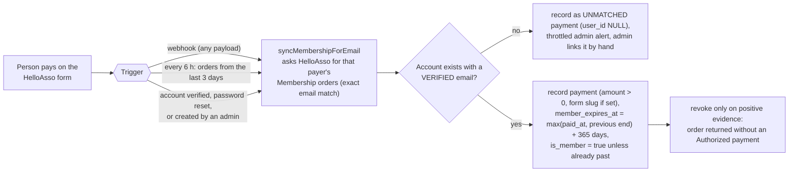

Manual admin grants (`/admin/members`) have no `member_expires_at` and are never
touched by the sync or the expiry sweep.

**Payment integrity.**

- Only an `Authorized` order with an amount **above 0** counts; if
  `HELLOASSO_MEMBERSHIP_FORM_SLUG` is set only that form counts.
- **Renewal arithmetic** (`expiryFromPayments`): payments are chained oldest
  first, each adding 365 days starting at `max(paid_at, previous end)`. Renewing
  at day 300 therefore ends 730 days after the first payment; re-running a sync
  never adds time twice (it is derived from the payments only). A result
  already in the past grants nothing.
- **Unmatched payments**: a payer email with no account, or an account whose
  email is not confirmed, is stored in `membership_payments` with
  `user_id NULL` and `unmatched_at` set (migration 063). The admin gets one
  alert per hour ("Membership payment from <email> matches no confirmed
  account"), `/admin/members` shows "Unmatched membership payments", and
  **Link to account** (search an account by email or name) attaches the payment
  and runs the grant in one transaction. The payment also attaches by itself if
  the account is later confirmed.
- **Access is checked live**: `attachUser` treats a member as active only while
  `is_member AND (member_expires_at IS NULL OR member_expires_at > now())`
  (`lib/memberStatus.js`); the 6-hourly sweep only tidies the flag.
- End dates are shown as Paris calendar dates (never `toISOString()`).

---

## 9. Background jobs

There is no job queue: a few `setInterval` timers in the web process, plus
GitHub Actions for work that must survive the site being down. Each timer's job
is wrapped by `guardJob` (`lib/jobGuard.js`): a run that is still in progress is
never overlapped by the next tick, which is skipped with one log line, and
every run is recorded in the `job_runs` table (see "Job tracking" below).


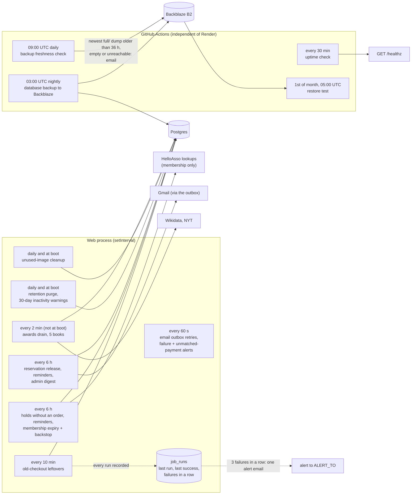

| Job | Where | Cadence | Notes |
|---|---|---|---|
| Leftover cleanup of the old online checkout | web process | 10 min | also on boot; releases any copy still `in_cart`; asks no payment provider |
| Expiry of copies held without an order, their reminder (day 11 of 14), membership expiry, membership backstop | web process | 6 h | read-time expiry also keeps pages right while idle; the backstop is the only HelloAsso call left (membership) |
| Reservation follow-up (`lib/orderSweeps.js`): release of reservations past their deadline and of ended seats, day-10 customer reminder, 24-hour seat reminder, "reservation ended" email, admin digest of reservations expiring within 2 days | web process | 6 h, first run 5 minutes after boot | no outside lookup; every email is claimed in the database before it is sent; see §7 |
| Email outbox worker | web process | 60 s (first run 15 s after boot) | retries unsent mail with backoff, one alert per hour when it gives up; also sends the throttled "membership payment matches no account" alert |
| Retention purge | web process | daily, and at boot | see below; also clears ended book requests and expired "find my requests" links |
| Unused-image cleanup | web process | daily, and at boot | deletes at most one batch of images older than 7 days that no row references (`lib/imageCleanup.js`) |
| Awards drain | web process | 2 min, not at boot | looks up awards for a few books at a time (§6); a no-op when `AWARDS_LOOKUPS=off` |
| Cover backfill | web process | 5 min, first run after 1 min | copies up to 20 book covers from their Open Library / archive.org source address into the `images` table, books on the shelves first; at most 3 failed attempts a week per cover, where only a 404, a placeholder or an invalid image counts as failed (a 5xx, timeout or network error does not, and 3 in a row stop the batch); sends a User-Agent with the site and a contact address; off with `COVER_BACKFILL=off` (`lib/coverStore.js`) |
| Uptime check | Actions | 30 min (about 1,440 billed minutes a month: see the runbook, section t) | emails on the **second** consecutive failure and on recovery |
| Database backup | Actions | 03:00 UTC | full dump to Backblaze B2 (required); a second copy on the 1st of the month |
| Restore test | Actions | monthly + manual | restores the newest Backblaze dump into a scratch Postgres and checks it (key tables, newest migration, images) |
| Test alert | Actions | every Monday + manual | sends one email so a broken alert channel is noticed within a week |
| Backup freshness check | Actions | 09:00 UTC daily + manual | emails if the newest nightly dump in Backblaze is older than 36 hours, empty, missing, or Backblaze cannot be reached; after the 3rd of the month also if the newest `monthly/` copy is over 35 days old (§12) |

**Job tracking** (`lib/jobRuns.js`, table `job_runs`, migration 081). A job used
to fail with only a `console.error` that nobody read. Now `guardJob(name, fn,
{ pool, intervalMs })` records `last_run_at`, `last_success_at`,
`consecutive_failures` and `last_error` (scrubbed of emails and long digit
runs) after every run. **Three failures in a row send one alert email** (through
`alertOnError`, `force`, to `ALERT_TO`), and the first success afterwards sends
one "recovered" note; if the database itself is down the in-memory counter still
raises the alert. The reservation job is four tracked jobs (reservation expiry,
pickup reminders, membership expiry, membership reconciliation; the last one now
throws when a payer's check failed, after trying the others), and **every
retention-purge step is its own row** (`Retention purge: tokens`, ...), fed by
`purgeExpiredPersonalData(pool, { onStep })`. The admin page
`/admin/diagnostics/jobs` (English, admin only) shows the table, and the
dashboard's "Needs attention" box lists a job with 3+ failures in a row or no
success for three times its interval (rows older than 30 days are ignored so a
removed job cannot nag forever).

**Once-per-period alerts** (`lib/alertFlags.js`, table `alert_flags`): an atomic
`INSERT ... ON CONFLICT ... WHERE last_sent_at < now() - period` claims the
slot, so the alert holds across restarts and instances, and the slot is handed
back if the alert mail itself fails. Used for the launch-guard alerts (once per
24 h each, instead of up to three emails on every deploy; a red banner on every
admin page shows the problem meanwhile) and the "email stuck in the outbox"
alert (any row pending over 60 minutes, once per 6 hours, counts per kind only).

**The daily retention purge** keeps the promises on the privacy page. It removes
event and class sign-ups 12 months after the date, expired reset and
verification tokens after 7 days, orders and payment records after 10 years,
contact details on ended reservations and on expired or cancelled reservations after
30 days, stored copies of sent emails after 30 days (failed ones after 90),
audit-log rows after 12 months, and book requests (never-confirmed ones
after 7 days, open ones after 12 months, and the contact details of closed ones
after 30 days). Accounts with no login for 3 years
(never admins, never current members) get an email warning first and are
deleted 30 days later unless they log in. Each step runs on its own, so one
failure does not stop the others.

On shutdown (`SIGTERM`/`SIGINT`) the timers are cleared, the server stops taking
connections, in-flight requests finish, the pool closes, and the process exits
(hard stop after 10 s).

---

## 10. Dates and times

Uma's Books is in Albi, so **every typed and displayed time means Europe/Paris**.
Render's servers run in UTC, which used to store a typed 18:00 as 18:00Z (20:00
in Paris in summer).

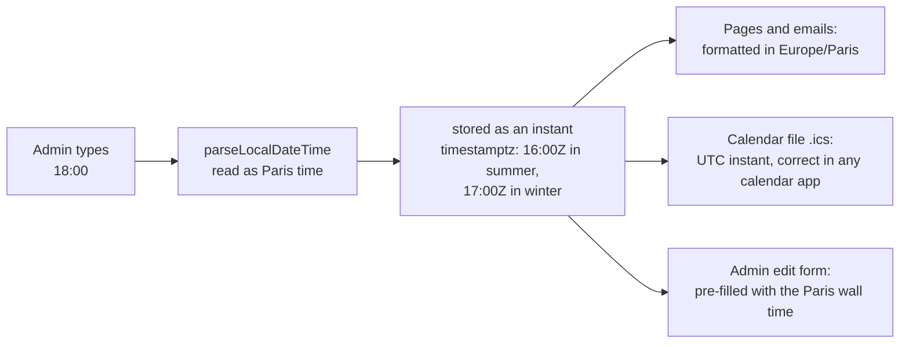

`src/lib/tz.js` pins the process timezone; weekly repeats keep the same wall-clock
time across the October and March clock changes; migration 033 corrected rows
stored the old way. Date-only fields (blog dates, announcement expiry) are
UTC-midnight values and unaffected.

---

## 11. Build, test and deploy

`main` is protected: nothing reaches it except through a pull request whose six
checks pass and whose branch is up to date. **A merge to `main` deploys to
production.**

```mermaid
flowchart LR
  DEV["Change on a branch"] --> PR["Pull request"]
  PR --> CI

  subgraph CI["GitHub Actions: six required checks"]
    direction TB
    c1["lint"]
    c2["test<br/>unit + integration,<br/>throwaway Postgres"]
    c3["migration-test<br/>all migrations on an empty DB + seed"]
    c4["dependency-audit<br/>npm audit"]
    c5["secret-scan"]
    c6["smoke-crawl<br/>log in as each persona,<br/>walk every page"]
  end

  CI --> MRG["Squash-merge to main<br/>(branch must be up to date)"]
  MRG --> RB["Render builds<br/>npm ci --omit=dev"]
  RB --> PD["preDeployCommand:<br/>npm run migrate<br/>a failed migration aborts the deploy,<br/>the old version keeps serving"]
  PD --> ST["start command:<br/>npm run seed; npm start"]
  ST --> HC["Render health check<br/>GET /healthz"]
  HC --> LIVE(["Live"])
```

* **Dependabot** opens weekly update pull requests for GitHub Actions and npm
  packages. It never merges anything: each one goes through the same six checks
  and a human review. Major upgrades of Express, EJS, bcryptjs and dotenv are
  deliberately not proposed (they need a planned migration). Third-party Actions
  are pinned to an exact commit, not a moving tag.
* Tests use a real Postgres; locally every test file gets its own throwaway
  database, but **in CI all files share one database and run concurrently** —
  so every test file that gets a database must pass `isolated: true` (own
  throwaway database on the same server); `test/unit/sharedDatabaseGuard.test.js`
  enforces it. See "Writing tests that are safe on the shared CI database" in
  `umas-books/README.md`.
* The smoke crawl and the tests switch the admin two-step requirement off
  (`ADMIN_2FA_REQUIRED=false`); the setting is ignored when `NODE_ENV=production`.
* Reproduce production's UTC environment on a Paris-timezone machine with
  `TZ=UTC PGOPTIONS='-c timezone=UTC'`.
* The smoke crawl is the slowest check (~10 minutes) and the main consumer of
  Actions minutes, which are metered on a private repo.

---

## 12. Backups, restore and monitoring

```mermaid
flowchart TB
  subgraph nightly["Nightly 03:00 UTC (GitHub Actions)"]
    G{"offsite settings<br/>all set?"} -- no --> E["any failure: email to admin"]
    G -- yes --> D["pg_dump --format=custom<br/>(client 18, 3 attempts,<br/>images included, sessions left out)"]
    D --> U[("Backblaze B2<br/>full/ every night,<br/>monthly/ copy on the 1st")]
    D --> E
    U --> E
  end

  subgraph monthly["Monthly restore test"]
    N["newest dump from Backblaze B2 (full/)"] --> RS["pg_restore into a scratch postgres:18"]
    RS --> CK["check key tables exist, row counts,<br/>at least one admin, image bytes present"]
    CK --> MG["newest migration in the dump >=<br/>newest migration file in the repo"]
    MG --> E2["failure: email to the alert addresses"]
  end

  subgraph fresh["Backup freshness check, daily 09:00 UTC"]
    FL["list newest dump under full/<br/>(and, after the 3rd, newest monthly/ under 35 days)"] --> FQ{"exists, not empty,<br/>fresh enough?"}
    FQ -- no --> E5["email to the alert addresses"]
    FQ -- yes --> FOK["ok, nothing sent"]
  end

  subgraph watch["Uptime check every 30 min"]
    H["GET /healthz"] --> OK{"database reachable?"}
    OK -- "fails twice in a row" --> E3["one alert email"]
    OK -- "recovers" --> E4["one recovery email"]
  end
```

* **Two layers.** Render's own point-in-time recovery (seven days) is the quick
  way back after a bad deploy or a mistaken delete; the Backblaze dumps are the
  independent copy that survives even losing the Render account.
* **Retention in Backblaze** is set by two lifecycle rules on the bucket, not by
  the workflow: nightly dumps under `full/` are hidden after 30 days and the
  1st-of-the-month copies under `monthly/` after 730 days (about two years).
* **Alert recipients.** Every alert (site and workflows) goes to `ALERT_TO`: one
  address or several separated by commas (Render env var for the site, GitHub
  repository **variable** of the same name for the workflows, default
  `admin@umasbooks.org`). All alerts are still *sent from* one Gmail account, so a
  second recipient on a **different provider** is advised, and a **weekly** test
  alert (Mondays) proves the channel works. The runbook (section d, q) has the
  click paths and a table of every alert with its first three actions.
* **External monitor.** UptimeRobot (free) checks `/healthz` every 5 minutes and
  alerts by email; the 30-minute GitHub uptime check stays as an independent
  second layer. `ALERT_TO` is `admin@umasbooks.org,sharonbje@gmail.com` in both
  Render and the GitHub variable.
* **Mail not configured is a failure, not "sent".** `mailer.sendMail` throws in
  production when `GMAIL_*` is unset (it only logs in tests and local
  development), so the outbox keeps and retries the message instead of marking it
  sent and blanking a login link.
* **Restore test coverage.** The monthly restore test checks that these tables
  exist after the restore: `users`, `books`, `book_copies`, `orders`,
  `schema_migrations`, `till_sales`, `till_days`, `till_sale_items`,
  `till_quick_items`, `shop_sales`, `email_outbox`, `membership_payments`,
  `admin_audit_log`, `images`; compares the highest filename in `schema_migrations`
  with the highest file in `umas-books/migrations` of the repository checkout (a
  migration added in the last 30 hours is a warning, an older one means the dump
  is stale); and the existing row, admin and image-byte checks.
* **Freshness check.** The nightly workflow emails when it *fails*, but cannot email
  if it never runs at all (workflow disabled, schedule dropped, a GitHub outage).
  `.github/workflows/backup-freshness.yml` therefore runs six hours after the
  backup, looks at Backblaze itself, and emails `admin@umasbooks.org` if the newest
  `full/` dump is older than 36 hours, is empty, or is missing, or if Backblaze
  cannot be reached or its settings are absent. From the 4th of each month it also
  requires the newest `monthly/` object to be under 35 days old, so a silently
  failing 1st-of-the-month copy is noticed. It uses the same `BACKUP_S3_*`
  settings and the Gmail secrets as the nightly job.
* **Dumps never go into the code repository**: they contain member names,
  emails, order details and password hashes, so they live only in the private
  Backblaze B2 bucket. All three backup workflows (nightly, restore test, freshness check) have read-only repository access.
* **What a dump holds.** Everything, including uploaded photos (they live in the
  database now) but not login sessions; after a restore everyone logs in again.
* **Restore procedure**: `umas-books/README.md` → "Restoring from a backup".
* **Application errors** go through `alertOnError` (one email per 15 minutes, so
  an outage can't flood the inbox); payment-money alerts bypass that throttle.
  Failing background jobs, stuck emails and launch warnings have their own
  once-per-outage / once-per-period alerts (section 9).
* **Actions minutes.** The repository is private (Free plan: 2,000 minutes a
  month; a full CI run is about 20 billed minutes, the uptime check about 1,440 a
  month). CI keeps its six required check names and always runs them, but a
  documentation-only pull request skips the install and test steps inside each
  job and the 10-minute smoke crawl runs only when the app, views, public files,
  migrations, scripts, package files, marketing pages or `.github/` changed (and
  always on `main`): see the header of `.github/workflows/ci.yml` and
  `.github/scripts/ci-changes.sh`. Measured numbers and the monthly usage check:
  runbook section t.
* **If the Render account is lost**: runbook section u) rebuilds everything from
  GitHub, `render.yaml` (which now lists every environment variable) and the
  newest Backblaze dump in 2 to 4 hours; sections v) and w) hold the accounts
  inventory and the second-owner / recovery-code checklist.
* **Offsite status**: Backblaze B2 is the only backup location and is required;
  the nightly job fails (and emails) if its settings are missing. The
  repository variables and secrets it needs are listed in `umas-books/README.md`.

* **Clearing test data before launch.** `npm run clear-test-data` (steps in
  `docs/runbook.md`, design in `umas-books/ARCHITECTURE.md`) is the only
  sanctioned way to empty the shop, accounts and logs. It is a dry run unless given
  `--execute`, the exact `--confirm` phrase naming the database and
  `--i-have-a-backup`; it refuses once `PREVIEW_MODE` is off; it runs as one
  transaction that rolls back if admins, two-step verification, `pricing_settings`
  or kept content would change; and every table in the schema must be classified in
  the script (a test fails otherwise). Take the nightly backup first: restoring it,
  or Render's seven-day point-in-time recovery, is the undo.

---

## 13. Security model

Layers, outermost first. A request must pass every one that applies to it.

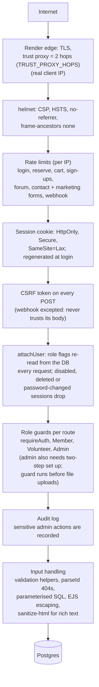

| Area | What is in place |
|---|---|
| Secrets | environment variables only (`sync: false` on Render; GitHub secrets for CI); `.env` is git-ignored; a secret scan runs on every PR; startup fails fast in production if `DATABASE_URL`, `SESSION_SECRET` or `TOTP_ENCRYPTION_KEY` are missing |
| Authentication | see §5; enumeration-resistant signup, login, reset; HIBP breach check; two-step verification mandatory for admins, secrets encrypted with `TOTP_ENCRYPTION_KEY` |
| Authorization | admin guard (including two-step) before multer; admins cannot demote, disable or delete themselves |
| Preview mode | `PREVIEW_MODE=true` switches reservations and the membership widget off, adds a banner, and sends `noindex, nofollow` (header, meta tag, `robots.txt`, empty sitemap), so an unfinished site cannot take reservations or payments or be indexed |
| Moderation | admins can hide forum posts with a reason code; the author gets a statement of reasons (EU Digital Services Act) and the action is audit-logged without the post text |
| AI features | optional and off without `ANTHROPIC_API_KEY`; the price lookup has its own switch and daily cap; a suggested price is never saved without a person confirming it |
| Book requests | double opt-in by emailed link, tokens stored as hashes, rate-limited, personal data cleared when a request ends |
| Admin audit log | member changes, erasure, data export, two-step resets, deletes, bulk deletes, book moves and repricing, shop sales, pricing-rule changes, award edits, book-request handling, forum hide and restore, report CSV downloads and admin logins are appended to `admin_audit_log` and shown read-only at `/admin/audit`; it keeps the admin's id and email, the action and a numeric target, never member emails or names; rows are purged after 12 months |
| CSP form-action | `'self'` only: no form of ours posts to another site and no redirect to another site follows a form POST (books and seats are reserved here and paid in the shop). The HelloAsso membership form is an iframe the visitor loads by pressing a button, allowed by `frame-src` on the marketing pages (`lib/marketingCsp.js`); `lib/helloassoHosts.js` now only tells whether `HELLOASSO_API_BASE` is the sandbox |
| Payments | membership only: never trust webhook or return-URL content, re-ask HelloAsso with our own credentials; reservation amounts computed server-side; idempotent state changes |
| Output | EJS auto-escapes; the only unescaped output is sanitised rich text or fixed markup; `esc()` in client code |
| Uploads | admin only, size-capped, decoded and re-encoded by `sharp` with a pixel cap; stored in the `images` table and served from `/img/<hash>.jpg` (hash-named, immutable, no cookie) |
| Email | one address only (no list separators), names stripped of links and angle brackets before going into mail; every customer email is stored in `email_outbox` first and retried (§7), stored copies are erased after 30 days |
| Transport to the database | `rejectUnauthorized: false` is deliberate: Render's internal Postgres uses a per-instance self-signed certificate on a private network |
| Supply chain | `npm audit` in CI; lockfile-exact builds; third-party Actions pinned by commit; weekly Dependabot pull requests, never auto-merged |
| Direct-origin bypass | on a live site any request whose Host is not the host of `APP_BASE_URL` is redirected (GET/HEAD) or answered `421 Misdirected Request` (every other method), except `/healthz` and `/webhooks/helloasso`. The `onrender.com` address skips Cloudflare, so its proxy chain is shorter than `TRUST_PROXY_HOPS` assumes and a client-supplied `X-Forwarded-For` could otherwise become `req.ip` and defeat the per-IP limits (`middleware/canonicalHost.js`) |
| Login lockout | per (account, IP) pair (5 wrong passwords, 15 minutes) plus a softer per-account total (20 in 15 minutes, refused only for addresses that never logged in to that account in the last 30 days), in memory (`lib/loginThrottle.js`): a stranger cannot lock the owner out. Two-step codes keep the per-account database lock |
| Cover downloads | https only, two allowed hosts, every address class blocked by a `node:net` BlockList (private, loopback, link-local, CGNAT, multicast, reserved, IPv4-mapped in dotted and hex form, NAT64, 6to4, Teredo); the name is resolved once and the connection goes to that checked address with the real Host and TLS server name (no DNS rebinding window) (`lib/coverStore.js`) |
| `/img` and static files | `/img` has a 300 per minute per IP limit on database reads (bad names and `If-None-Match` answers are free and never read the database). `public/`, `/assets` and `/logo.png` are mounted before helmet, so they set `nosniff`, `Referrer-Policy: no-referrer` and `Cross-Origin-Resource-Policy: cross-origin` themselves (`lib/assetUrl.js` `staticHeaders`). A `?v=` URL is immutable for a year, so on a deploy the new files must exist before old HTML stops pointing at them (the rolling deploy keeps serving old HTML from old instances that also have the old files; never delete a file a page still links in the same release) |
| `/healthz` | the `SELECT 1` answer is cached for 3 seconds and a failed last check answers 503 (`lib/health.js`), so polling it cannot become a query loop |
| Marketing CSP | the marketing pages share an origin with `/admin`, so `script-src` is `'self'` only (no `'unsafe-inline'`) and `script-src-attr 'none'`. The pages carry no inline script: their strings are a `<script type="application/json" id="page-i18n-data">` block read by `public/page-i18n.js`, and page code lives in `public/page-*.js` |
| Caching | pages shown to a logged-in user are sent `no-store` (the Back button after logout shows nothing private); only `/img/` photos stay cacheable |

**Personal data (GDPR).** Most personal data is keyed by email address, not by
account id, so deleting a user row alone would leave orders, sign-ups and
reservations behind. The code handles it in one place (`lib/privacy.js`):

* **Erase member** (admin, Members page) deletes the account, its sign-ups and
  sessions, releases an active reservation, and *anonymises* paid orders and
  HelloAsso membership payment rows, which French accounting law requires us to keep for 10
  years. Forum posts keep their text without an author name.
* **Retention**: the daily purge in §9 enforces the periods the privacy policy
  states; the policy page and the constants in the code must change together.
* **Members can help themselves** on **Account, Privacy** (`/account/privacy`):
  download their own data as a file, or delete their own account. Both need the
  current password (wrong attempts are throttled per account); deletion also
  needs the typed word DELETE (or SUPPRIMER), is refused for admins, sends a
  confirmation email and then runs the same erase as above.
* **Admin data export**: on a member's page an admin can download everything held
  about them as JSON (right of access). Password hashes, tokens and two-step
  secrets are never included.
* **Requests without an account** (admin, `/admin/privacy`,
  `lib/privacyRequests.js`): look an email address up, download everything held
  under it (member exports for each account plus the address-keyed sections, via
  `lib/memberExport.js`), or erase it (typed address, one transaction:
  `eraseMember` for each account, `eraseEmailKeyedData` for the rest, outbox rows
  by recipient and by `subject_email`; paid orders and payments anonymised). The
  audit entry holds a keyed hash of the address, never the address; an
  administrator's address is refused. Procedure: `docs/runbook.md`, "A data
  request".
* **Audit log retention:** free text (`detail`) is blanked after 6 months
  (`RETENTION.auditDetailMonths`, a refund note or void reason can name a
  customer); the row (action, admin, time) stays 12 months. The Accounts report
  page view is logged (`reports.accounts.view`, once an hour per admin).
* Contact-form messages stay in the Gmail inbox and server logs stay with Render;
  neither is purged automatically. The processing register and breach log are in
  `docs/privacy/`.

---

## 14. Configuration reference

The environment-variable inventory lives in **one** place, so it cannot drift:
[`umas-books/ARCHITECTURE.md`, "Environment variables"](../umas-books/ARCHITECTURE.md#environment-variables).
It lists every variable the code reads, whether it is required, its default,
whether it is a secret, and exactly where it is set (Render environment variable,
GitHub repository variable or GitHub secret). A test (`test/unit/envInventory.test.js`)
fails when the code reads a variable that table does not list.

In short: three variables are required (`DATABASE_URL`, set by hand in Render;
`SESSION_SECRET` and `TOTP_ENCRYPTION_KEY`, generated by Render; the boot in
production fails without them, `lib/env.js`). Mail, HelloAsso, Anthropic and the
book-lookup keys are optional and switch their feature off when unset.
`render.yaml` declares what a Blueprint rebuild needs; `PREVIEW_MODE` is
**deliberately absent** (set and removed by hand in the dashboard). The GitHub
workflows use their own repository secrets and variables (backups, alerts), listed
in the second table of that section.

## 15. Limits, trade-offs and known gaps

Deliberate trade-offs (revisit only if traffic or risk changes):

* **One instance, in-memory rate limits and timers.** Limits reset on restart; two
  instances would each run every sweep (the inactivity-warning email is claimed
  before sending so it would not be doubled, the other jobs are not guarded). Fine
  for one small shop; a shared store or advisory-lock-guarded jobs would be the
  first scale-up step.
* **Per-request user lookup** (`attachUser`) — one primary-key read per logged-in
  request, deliberate for instant revocation.
* **Photos live in Postgres.** They have their own `images` table and are served
  with a year-long cache, so they no longer bloat pages or JSON, but they do make
  the database and every backup bigger. A daily job deletes images that are over
  7 days old and that no row references any more (a replaced cover is cleaned up
  after a week); re-uploads of the same file share one row. Object storage is the proper next step
  and would need no change to the URLs.
* **No `hreflang` pairs.** English and French share ONE URL (the language comes from
  the `umasbooks_lang` cookie, see section 4), so search engines cannot be told
  "this is the French version of that page". Every page carries only
  `<link rel="alternate" hreflang="x-default">` pointing at itself. Real pairs would
  need separate URLs (`/fr/...`) per language: a larger change, not planned.
* **Phone header = a `<details>` menu.** From 641px the nav is always visible
  (`public/site-menu.js` opens it; without JavaScript a browser too old for
  `::details-content` would show a closed menu on desktop). On phones the menu
  and the preview banner's More link are native `<details>`, so they work without
  JavaScript.
* **Search is `ILIKE '%q%'`** over a few thousand books — fine now; trigram or
  full-text indexes when the catalogue grows.
* **One Google Workspace mailbox** (`admin@umasbooks.org`) sends both human and
  system mail: roughly 2,000 messages a day, signed by Google (SPF is in place;
  confirm DKIM in the Google Admin console and add a DMARC record in the
  Squarespace DNS). Plenty for this site; a transactional provider is not needed.
* **Languages are English and French only**, and admin screens (and admin-only
  alert emails) are English only. French is rendered on the server everywhere
  else. The marketing pages keep one EN and one FR dictionary each, used both by
  the server (to send French HTML) and by the toggle script; a new marketing string
  goes in both dictionaries, and a new page needs `meta.title` and
  `meta.description` entries. French typography in the dictionaries (no-break space
  before `; : ! ? €`) is enforced by a unit test; the `tr()` strings in the app views get
  the same spacing from `lib/frenchTypography.js` when the page is sent.
* **Awards and price lookups depend on outside services.** Wikidata, the NYT
  API and the AI price search can be slow, wrong or unavailable; every call has a
  timeout, failures are retried later, and a price is only ever a suggestion. The
  daily cap bounds the Anthropic cost.

Open items worth knowing:

* Reserving is limited to account holders with a confirmed email, to 10 books and
  3 open reservations per account, and books are held 14 days (7 more if an admin
  extends once). The old public `POST /books/:id/reserve` route stays removed
  (anyone could hold copies under any email address); copies can still be held
  for someone by an admin or by the book-request flow, without an order.
* The site never moves money for a reservation: the payment and any refund are
  done in the shop, and staff record them (**Mark collected and paid**, **Mark
  refunded**). Until a refund is marked, the books stay marked sold and the
  sale still counts. A partial refund of an order cannot be recorded; the order
  would have to be split by hand.
* A reservation that is not collected costs nothing and has no penalty: after the deadline the
  items simply go back on sale (terms of sale and `docs/legal-todos.md` section
  4). A customer can reserve again straight away.
* Whether a reservation paid in the shop is a distance contract (and so has a
  withdrawal right) is an open legal question (`docs/legal-todos.md`, section 7).
  Following a legal review, the site treats a reservation as a free, non-binding
  hold and shows no withdrawal notice or form for books and seats (withdrawal
  text stays only for the online membership payment); the lawyer is asked to
  confirm.
* Revenue is counted on the day staff record the payment (`paid_at`), not the day
  of the reservation; a payment recorded days after it was taken lands in the
  day it was recorded.
* The 6-hourly membership backstop only looks at orders from the last 3 days;
  older missed payments rely on the webhook or account verification.
* If the only admin loses their phone and recovery codes there is nobody to reset
  them; the fix is a one-line database update in the Render shell (see
  `umas-books/ARCHITECTURE.md`).
* The unique-ISBN index is skipped by its migration if duplicate ISBNs existed
  when it ran; it has to be created by hand after merging them.
* Backblaze lifecycle rules are set in the Backblaze console, not in code. The
  freshness check notices a missing or stale newest nightly dump, but would not
  notice the rules being changed (for example the monthly copies expiring early).
* Only the newest `full/` dump is checked for freshness; the `monthly/` copy on
  the 1st is not checked separately.
* Price suggestions record what was suggested and what the volunteer chose
  (`suggested_price`, `price_basis`) but nothing yet uses that data to tune the
  rules or reports on it.
* Migration numbers 049, 051 and 052 do not exist (the sequence has gaps); that is
  harmless, the runner applies whatever files exist, but do not "fill" the gaps.
* The daily image cleanup only keeps images that a known column references;
  a new image-bearing column must be added to `IMAGE_REFERENCES` in
  `lib/imageCleanup.js` (a test fails if it is forgotten).
* Squarespace-era files (`SQUARESPACE.md`, `squarespace-*.html`, `tools/`) remain
  in the repo root, unused.
