# Uma's Books — architecture overview

A complete picture of how the site is built, runs, is deployed, backed up and
protected. Every diagram below is [Mermaid](https://mermaid.js.org/) and renders
directly on GitHub. For file-level detail (route table, environment variables,
migration rules) see [`umas-books/ARCHITECTURE.md`](../umas-books/ARCHITECTURE.md);
for running and restoring it see [`umas-books/README.md`](../umas-books/README.md).

This describes `main` as of 4 October 2026.

## Contents

1. [The system at a glance](#1-the-system-at-a-glance)
2. [Technology](#2-technology)
3. [Inside the web app](#3-inside-the-web-app)
4. [Request lifecycle](#4-request-lifecycle)
5. [Accounts, sessions and roles](#5-accounts-sessions-and-roles)
6. [Data model](#6-data-model)
7. [Money: checkout and payment reliability](#7-money-checkout-and-payment-reliability)
8. [Membership](#8-membership)
9. [Background jobs](#9-background-jobs)
10. [Dates and times](#10-dates-and-times)
11. [Build, test and deploy](#11-build-test-and-deploy)
12. [Backups, restore and monitoring](#12-backups-restore-and-monitoring)
13. [Security model](#13-security-model)
14. [Configuration reference](#14-configuration-reference)
15. [Limits, trade-offs and known gaps](#15-limits-trade-offs-and-known-gaps)

---

## 1. The system at a glance

One Node.js process serves **everything**: the public marketing site, the
members area and the admin. It talks to one Postgres database and a handful of
outside services. GitHub holds the code, runs the tests, and takes the backups;
the backups are stored in Backblaze, not in the code repository.

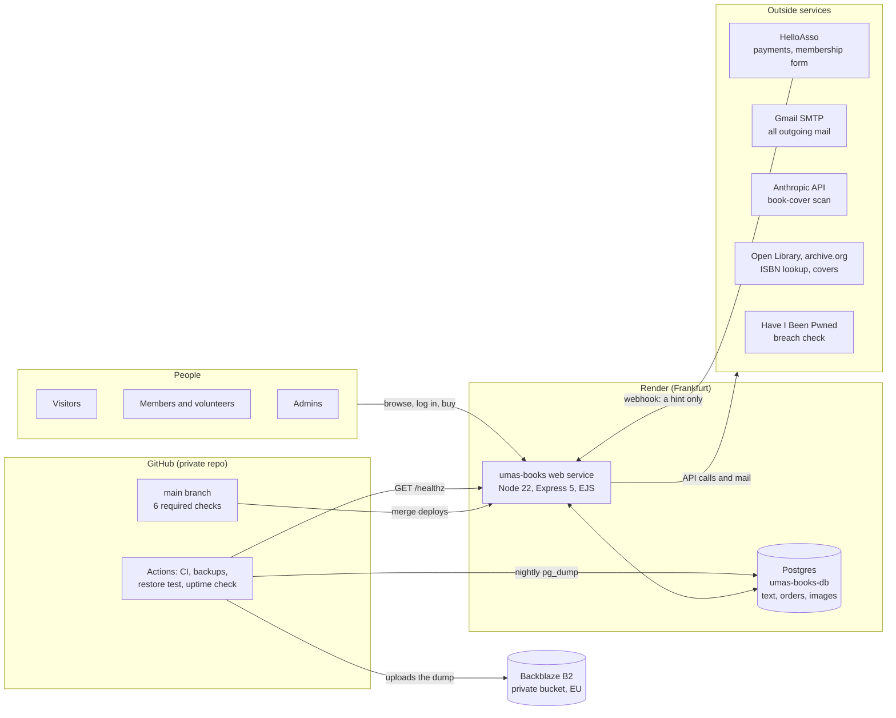

**Two layers of backup.** Render keeps its own seven-day point-in-time recovery
for the database; on top of that a nightly dump (uploaded photos included) goes
to a private Backblaze B2 bucket that Render cannot touch. See §12.

**Why one app.** Squarespace was retired; the marketing pages are EJS views in
the same Express process as the members area, so there is one deployment, one
login, one database and one thing to monitor.

---

## 2. Technology

| Layer | Choice | Notes |
|---|---|---|
| Runtime | Node.js 22 (`engines: 22.x`) | pinned in `package.json`, `umas-books/.node-version` and CI |
| Web | Express 5 | rejected async handler promises reach the error handler natively |
| Views | EJS, server-rendered | marketing views in `views/marketing/`; English and French via `tr()` (§3) |
| Database | PostgreSQL (Render, `1c-2g`) | `pg` pool; `timestamptz` everywhere |
| Sessions | `express-session` + `connect-pg-simple` | rows in table `session`; 30-day sliding cookie |
| Security middleware | `helmet` (CSP, HSTS), `express-rate-limit`, custom CSRF | |
| Uploads | `multer` (memory) + `sharp` re-encode to JPEG | admin only; bytes stored in the `images` table, served at `/img/<hash>.jpg` |
| Two-step login | TOTP authenticator app (`lib/totp.js`) | required for admins; the secret is encrypted in the database |
| Mail | `nodemailer` over Google Workspace SMTP | one mailbox (`admin@umasbooks.org`) for human and system mail |
| Payments | HelloAsso (checkout intents + hosted membership form) | OAuth client credentials |
| Hosting | Render Blueprint (`render.yaml`) | web `1c-2g`, database `1c-2g`, Frankfurt |
| CI/CD | GitHub Actions + Dependabot | six required checks; Render deploys on merge; actions pinned by commit |

---

## 3. Inside the web app

The app lives in [`umas-books/`](../umas-books/). The repo root holds only the
static files the marketing pages load (`assets/`, `logo.png`), `render.yaml`, CI
config and docs.

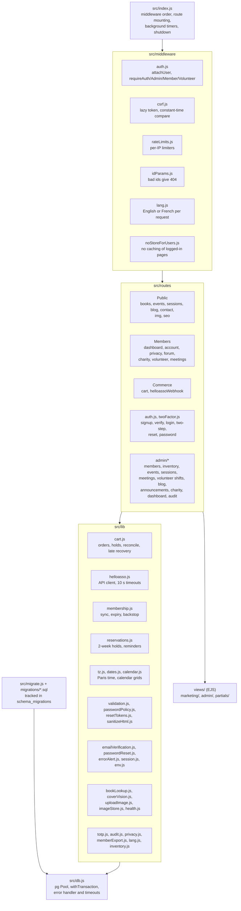

Conventions that hold across the code:

* **No ORM.** Plain parameterised SQL; the only interpolated pieces are constants.
* **`withTransaction(pool, fn)`** is the only way multi-step writes are done; a
  failing `ROLLBACK` can't mask the original error.
* **Comments explain why**, and reference the incident that caused the code.

**Languages.** Everything visitors and members see is available in English and
French; admin screens stay English. A cookie, `umasbooks_lang`, is written by
the EN/FR toggle in the page header. The `lang.js` middleware runs before the
login check and reads only headers (so it never touches the session or the
database): French when the cookie says `fr`, otherwise the browser's
`Accept-Language`, otherwise English. Views call `tr('English', 'Français')`
and server code calls `req.tr(...)`. Emails follow the reader's stored language:
`users.lang` (set at signup, refreshed at login) and `orders.lang` (set at
checkout); an empty value means English. The marketing pages keep their own
in-page dictionaries and are only partly rendered in French on the server.

---

## 4. Request lifecycle

Order matters here — the registration order in `src/index.js` *is* the design.
Static files and uploaded images are served before the session so that they
never cost a session or user lookup, and the HelloAsso webhook is mounted before
CSRF because it is an external POST with no token.

```mermaid
flowchart TD
  R([Incoming request]) --> C["compression"]
  C --> S1["Static files<br/>/public, /assets, /logo.png<br/>(7-day cache)"]
  S1 --> IM["GET /img/hash.jpg<br/>photo bytes from the images table,<br/>cached for a year, no cookie"]
  IM --> H["GET /healthz<br/>SELECT 1, 3 s limit, 503 on failure"]
  H --> SEO["robots.txt, sitemap.xml"]
  SEO --> HEL["helmet<br/>CSP, HSTS, no-referrer"]
  HEL --> U["urlencoded body parser"]
  U --> SES["express-session<br/>Postgres store, cookie umasbooks.sid"]
  SES --> REF["session refresh<br/>saved at most once a day"]
  REF --> LG["language<br/>cookie or Accept-Language"]
  LG --> AU["attachUser<br/>re-reads role flags, disabled,<br/>password_changed_at by primary key"]
  AU --> NS["logged-in pages: no-store"]
  NS --> LOC["view locals<br/>user, cart count, lazy CSRF token"]
  LOC --> UP["admin upload mounts<br/>requireAdmin first, then multer"]
  UP --> WH["POST /webhooks/helloasso<br/>rate-limited, before CSRF"]
  WH --> CS["csrfProtection<br/>every other POST"]
  CS --> API["/api/csrf-token, /api/session"]
  API --> MK["marketing pages, legal pages<br/>(MARKETING_PAGES list)"]
  MK --> RM["route modules<br/>auth, two-step, dashboard, account, privacy,<br/>forum, charity, volunteer, meetings, events,<br/>blog, sessions, books, cart, contact, admin"]
  RM --> NF["404 page"]
  NF --> ER["error handler<br/>log, alert email, 500 page"]
```

---

## 5. Accounts, sessions and roles

Roles are flags on `users`: `is_admin`, `is_member`, `is_volunteer`, plus
`is_disabled`. They are **re-read from the database on every logged-in request**
by `attachUser`, so disabling someone, demoting an admin, or changing a password
takes effect on their very next request — including on other devices.

```mermaid
stateDiagram-v2
  [*] --> Anonymous
  Anonymous --> Signup: POST /signup
  Signup --> Unverified: neutral notice, same page whether or not the email exists, plus a verification email
  Unverified --> Verified: GET /verify-email/:token, sets email_verified_at
  Unverified --> LoggedIn: login (allowed before verifying)
  Verified --> LoggedIn: login
  Verified --> TwoStep: password right, two-step switched on
  TwoStep --> LoggedIn: authenticator code or one-time recovery code
  TwoStep --> Anonymous: 5 minutes pass or too many wrong codes
  LoggedIn --> LoggedIn: attachUser re-checks the row every request
  LoggedIn --> Anonymous: logout, disabled, deleted, or password changed elsewhere
  Anonymous --> Reset: POST /forgot-password (neutral reply)
  Reset --> Verified: reset link used once; also verifies the email and clears the lockout
```

Key rules:

* **Passwords** — bcrypt cost 12, minimum policy plus a Have-I-Been-Pwned
  k-anonymity breach check; a locked account (5 failures, 15 min) answers like a
  wrong password; the lockout counter is one atomic `UPDATE`. Wrong two-step
  codes count toward the same lockout.
* **Sessions** — id regenerated at login; the session is **saved before the
  redirect** (`lib/session.js`) because `express-session` otherwise answers
  before its write lands; cookie `HttpOnly`, `Secure`, `SameSite=Lax`.
* **Two-step verification (TOTP).** Any authenticator app works. It is
  **mandatory for admins** and optional for everyone else: `requireAdmin` sends an
  admin who has not enrolled to `/account/2fa` and nothing else works until they
  do. At login the password only opens a five-minute "pending" step; the 6-digit
  code (or a one-time recovery code, ten are issued at setup) completes the
  login. A code cannot be replayed, and enrolling needs the account password
  again. The secret is stored encrypted (AES-256-GCM) with the key
  `TOTP_ENCRYPTION_KEY`, so a database copy alone does not reveal it. An admin
  who loses their phone and codes is reset by another admin (**Reset Two-Step**
  on the Members page, written to the audit log); non-admins can switch it off
  themselves, admins cannot.
* **Email verification gates identity-sensitive features**: order history on
  `/account` and automatic membership attribution both require
  `email_verified_at`. Accounts created by an admin are verified immediately
  (the invite link proves the mailbox); existing accounts at migration 032 were
  grandfathered as verified.
* **CSRF** — a per-session token created lazily, compared in constant time;
  `/api/csrf-token` saves the session before answering.
* **Rate limits** are in memory (reset on restart) and mostly per IP: login 20
  failures / 15 min, sign-up 30/h, password reset requests 10 / 15 min, reserve
  5/h and 10/day, checkout 10/h, cart edits 60 / 15 min, event sign-up 10/h,
  forum posts 10/h and replies 30/h, charity ideas 10/h, contact 5 / 15 min,
  webhook 300 / 5 min. A few are per account instead: wrong two-step codes,
  wrong current password (password change, download or delete of your own data),
  forum reports. See `src/middleware/rateLimits.js` and the route files.

---

## 6. Data model

31 application tables (plus `schema_migrations` and the session table), grouped by what they belong to. Foreign keys below are the real
ones from `migrations/`. (`event_rsvps` is unused; `wishlist_requests` was dropped
in migration 029.)

```mermaid
erDiagram
  users ||--o{ email_verification_tokens : "proves mailbox"
  users ||--o{ totp_recovery_codes : "one-time codes"
  users ||--o{ password_reset_tokens : "resets"
  users ||--o{ membership_payments : "HelloAsso payments"
  users ||--o{ forum_threads : writes
  forum_threads ||--o{ forum_replies : has
  users ||--o{ forum_replies : writes
  users ||--o{ favorites : saves
  books ||--o{ favorites : "is saved as"

  books ||--o{ book_copies : "physical copies"
  orders ||--o{ book_copies : "holds in cart"
  orders ||--o{ order_items : contains
  book_copies ||--o{ order_items : "sold as"
  classes ||--o{ class_dropin_seats : "paid seats"
  orders ||--o{ class_dropin_seats : holds
  class_dropin_seats ||--o{ order_items : "sold as"

  events ||--o{ event_signups : "public sign-ups"
  classes ||--o{ class_signups : "pre-registration"
  events ||--o{ announcements : "linked from"
  users ||--o{ blog_posts : writes

  volunteer_shifts ||--o{ volunteer_signups : "slots"
  users ||--o{ volunteer_signups : books
  meetings ||--o{ meeting_rsvps : "RSVPs"
  users ||--o{ meeting_rsvps : answers

  charity_rounds ||--o{ charity_options : offers
  charities ||--o{ charity_options : "appears as"
  charity_options ||--o{ charity_votes : "receives"
  users ||--o{ charity_votes : casts
  charities ||--o{ charity_ideas : "approved from"
  users ||--o{ charity_ideas : suggests
```

| Domain | Tables | Notes |
|---|---|---|
| Accounts | `users`, `email_verification_tokens`, `password_reset_tokens`, `totp_recovery_codes`, `session`, `schema_migrations` | tokens and recovery codes stored as hashes; `users` also holds `lang`, the encrypted two-step secret and `inactivity_warned_at`; `session` is created by the store |
| Shop | `books`, `book_copies`, `orders`, `order_items`, `class_dropin_seats` | an order line is *either* a copy *or* a seat (CHECK constraint); copy status `in_stock / reserved / in_cart / sold`; one row per ISBN (unique index) |
| Images | `images` | content-addressed: id is the SHA-256 of the bytes; `books.cover_url` and the announcement, charity and blog image columns hold only the short `/img/<hash>.jpg` URL |
| Admin | `admin_audit_log` | who, what, numeric target id, time and IP; no member emails or names; purged after 12 months |
| Membership | `membership_payments` | one row per HelloAsso membership order; drives `member_expires_at` |
| Programs and events | `events`, `event_signups`, `classes`, `class_signups` | a `classes` row is a program session; `dropin_price` set = bookable |
| Community | `forum_threads`, `forum_replies`, `announcements`, `blog_posts`, `favorites` | rich text goes through `sanitize-html` |
| Volunteering | `volunteer_shifts`, `volunteer_signups`, `meetings`, `meeting_rsvps` | |
| Charity vote | `charity_rounds`, `charity_options`, `charity_votes`, `charities`, `charity_ideas` | a library of charities reused across rounds |

Three details of the shop tables worth knowing:

* **Inventory locations.** `book_copies.location` is free text per physical copy
  (trimmed, upper-case); there is no locations table, the drop-down is simply the
  distinct values already used. The admin **Move books** page moves one copy per
  scanned ISBN and writes each move to the audit log.
* **Fixed price for new books (loi Lang).** A copy whose condition is `new` must
  carry `publisher_price` and be priced between 95% and 100% of it, checked on
  the server when a copy is added or edited. Used copies are free-priced.
* **Order extras.** `orders.withdrawal_waiver_at` records the buyer's tick-box
  asking for a drop-in session to take place on its date (no withdrawal after);
  `orders.client_ip` supports the pending-order cap in §7; `orders.lang` sets the
  language of the confirmation email.

**Migrations** (`src/migrate.js`) run on every boot but each file applies
exactly once: a `schema_migrations` table, a per-file transaction and an
advisory lock. A pre-existing database is baselined, not re-migrated. Never edit
a deployed migration — add a new numbered file.

---

## 7. Money: checkout and payment reliability

Principle: **the webhook body is never trusted.** HelloAsso's notification and
the buyer's return URL are only *hints to re-ask HelloAsso*; the authoritative
payment state always comes from a server-to-server lookup with our own
credentials.

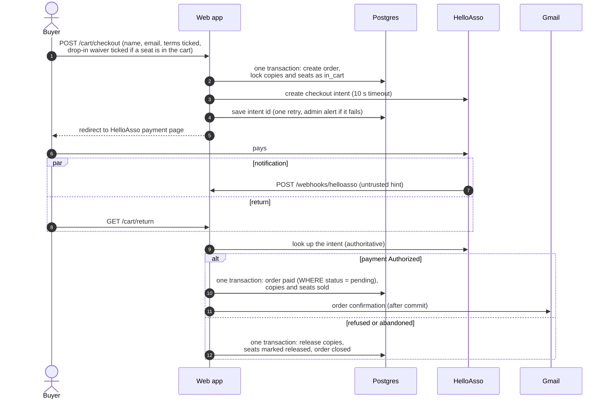

What keeps it correct:

| Concern | Mechanism |
|---|---|
| Double delivery / webhook racing the sweep | `UPDATE orders SET status='paid' … WHERE status='pending'`; the loser gets `rowCount = 0` and stops |
| Crash between "paid" and "sold" | both happen in **one transaction** (`markOrderPaid`) |
| Abandoned checkouts | a hold lasts 60 minutes; every 10 minutes the sweep releases stale holds, including drop-in-only ones |
| Releasing an order that actually paid | `releaseCartHold` locks the order row first; if already paid it finishes marking copies sold instead |
| Drop-in seat rows | marked `released`, never deleted (`order_items` references them); capacity ignores released seats |
| Payment lands **after** the hold expired | hourly, orders closed in the last 7 days are re-checked; if every item can still be claimed the order is completed, otherwise nothing is changed and the admin gets an alert email naming order, buyer and amount for a manual refund |
| Checkout crashes before saving the intent id | the same alert, with order and intent ids; the webhook may adopt the id if HelloAsso confirms the order id |
| Overselling | atomic `UPDATE … WHERE status='in_stock'` and `FOR UPDATE` on class rows |
| Hoarding stock without paying | a cart holds at most 20 lines; at most 2 unpaid orders per email and per IP address (`orders.client_ip`), checked under an advisory lock so two simultaneous checkouts cannot both slip through; at most 5 active reservations per email |
| Terms and withdrawal | checkout requires accepting the terms of sale; a cart with a drop-in seat also requires the withdrawal waiver, whose time is stored on the order |

---

## 8. Membership

Membership is sold on a **HelloAsso-hosted form** (embedded as an iframe — the
marketing CSP needs `frame-src https://www.helloasso.com`), not through our
cart, so there is no local order row. The link back to an account is the **payer's
email address**.

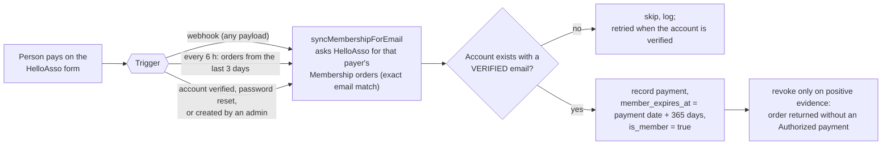

Manual admin grants (`/admin/members`) have no `member_expires_at` and are never
touched by the sync or the expiry sweep.

---

## 9. Background jobs

There is no job queue: a few `setInterval` timers in the web process, plus
GitHub Actions for work that must survive the site being down.

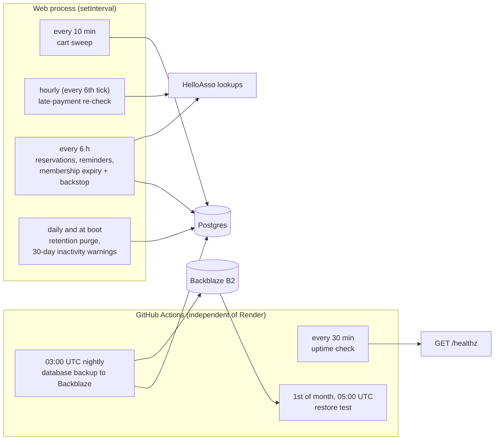

| Job | Where | Cadence | Notes |
|---|---|---|---|
| Cart hold expiry, order reconcile | web process | 10 min | also on boot |
| Late-payment re-check | web process | hourly | only orders closed in the last 7 days |
| Reservation expiry, pickup reminder (day 11 of 14), membership expiry, membership backstop | web process | 6 h | read-time expiry also keeps pages right while idle |
| Retention purge | web process | daily, and at boot | see below |
| Uptime check | Actions | 30 min | emails on the **second** consecutive failure and on recovery |
| Database backup | Actions | 03:00 UTC | full dump to Backblaze B2 (required); a second copy on the 1st of the month |
| Restore test | Actions | monthly + manual | restores the newest Backblaze dump into a scratch Postgres and checks it |

**The daily retention purge** keeps the promises on the privacy page. It removes
event and class sign-ups 12 months after the date, expired reset and
verification tokens after 7 days, orders and payment records after 10 years,
contact details on ended reservations and on expired or cancelled orders after
30 days, and audit-log rows after 12 months. Accounts with no login for 3 years
(never admins, never current members) get an email warning first and are
deleted 30 days later unless they log in. Each step runs on its own, so one
failure does not stop the others.

On shutdown (`SIGTERM`/`SIGINT`) the timers are cleared, the server stops taking
connections, in-flight requests finish, the pool closes, and the process exits
(hard stop after 10 s).

---

## 10. Dates and times

Uma's Books is in Albi, so **every typed and displayed time means Europe/Paris**.
Render's servers run in UTC, which used to store a typed 18:00 as 18:00Z (20:00
in Paris in summer).

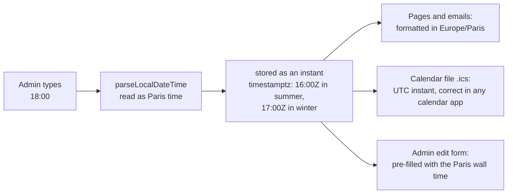

`src/lib/tz.js` pins the process timezone; weekly repeats keep the same wall-clock
time across the October and March clock changes; migration 033 corrected rows
stored the old way. Date-only fields (blog dates, announcement expiry) are
UTC-midnight values and unaffected.

---

## 11. Build, test and deploy

`main` is protected: nothing reaches it except through a pull request whose six
checks pass and whose branch is up to date. **A merge to `main` deploys to
production.**

```mermaid
flowchart LR
  DEV["Change on a branch"] --> PR["Pull request"]
  PR --> CI

  subgraph CI["GitHub Actions: six required checks"]
    direction TB
    c1["lint"]
    c2["test<br/>unit + integration,<br/>throwaway Postgres"]
    c3["migration-test<br/>all migrations on an empty DB + seed"]
    c4["dependency-audit<br/>npm audit"]
    c5["secret-scan"]
    c6["smoke-crawl<br/>log in as each persona,<br/>walk every page"]
  end

  CI --> MRG["Squash-merge to main<br/>(branch must be up to date)"]
  MRG --> RB["Render builds<br/>npm ci --omit=dev"]
  RB --> PD["preDeployCommand:<br/>npm run migrate<br/>a failed migration aborts the deploy,<br/>the old version keeps serving"]
  PD --> ST["start command:<br/>npm run seed && npm start"]
  ST --> HC["Render health check<br/>GET /healthz"]
  HC --> LIVE(["Live"])
```

* **Dependabot** opens weekly update pull requests for GitHub Actions and npm
  packages. It never merges anything: each one goes through the same six checks
  and a human review. Major upgrades of Express, EJS, bcryptjs and dotenv are
  deliberately not proposed (they need a planned migration). Third-party Actions
  are pinned to an exact commit, not a moving tag.
* Tests use a real Postgres; locally every test file gets its own throwaway
  database, but **in CI all files share one database and run concurrently** —
  tests must never do anything global to a shared table (use
  `startTestApp({ isolated: true })`).
* The smoke crawl and the tests switch the admin two-step requirement off
  (`ADMIN_2FA_REQUIRED=false`); the setting is ignored when `NODE_ENV=production`.
* Reproduce production's UTC environment on a Paris-timezone machine with
  `TZ=UTC PGOPTIONS='-c timezone=UTC'`.
* The smoke crawl is the slowest check (~10 minutes) and the main consumer of
  Actions minutes, which are metered on a private repo.

---

## 12. Backups, restore and monitoring

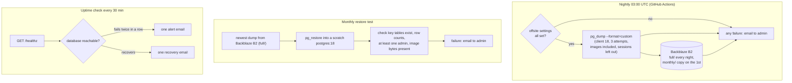

* **Two layers.** Render's own point-in-time recovery (seven days) is the quick
  way back after a bad deploy or a mistaken delete; the Backblaze dumps are the
  independent copy that survives even losing the Render account.
* **Retention in Backblaze** is set by two lifecycle rules on the bucket, not by
  the workflow: nightly dumps under `full/` are hidden after 30 days and the
  1st-of-the-month copies under `monthly/` after 730 days (about two years).
* **Dumps never go into the code repository**: they contain member names,
  emails, order details and password hashes, so they live only in the private
  Backblaze B2 bucket. Both backup workflows have read-only repository access.
* **What a dump holds.** Everything, including uploaded photos (they live in the
  database now) but not login sessions; after a restore everyone logs in again.
* **Restore procedure**: `umas-books/README.md` → "Restoring from a backup".
* **Application errors** go through `alertOnError` (one email per 15 minutes, so
  an outage can't flood the inbox); payment-money alerts bypass that throttle.
* **Offsite status**: Backblaze B2 is the only backup location and is required;
  the nightly job fails (and emails) if its settings are missing. The
  repository variables and secrets it needs are listed in `umas-books/README.md`.

---

## 13. Security model

Layers, outermost first. A request must pass every one that applies to it.

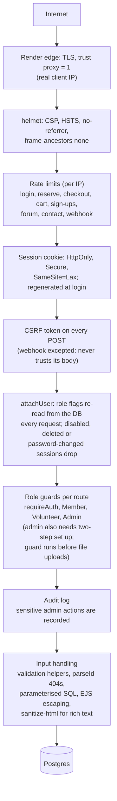

| Area | What is in place |
|---|---|
| Secrets | environment variables only (`sync: false` on Render; GitHub secrets for CI); `.env` is git-ignored; a secret scan runs on every PR; startup fails fast in production if `DATABASE_URL` or `SESSION_SECRET` are missing |
| Authentication | see §5; enumeration-resistant signup, login, reset; HIBP breach check; two-step verification mandatory for admins, secrets encrypted with `TOTP_ENCRYPTION_KEY` |
| Authorization | admin guard (including two-step) before multer; admins cannot demote, disable or delete themselves |
| Admin audit log | member changes, erasure, data export, two-step resets, deletes, bulk deletes, book moves and admin logins are appended to `admin_audit_log` and shown read-only at `/admin/audit`; it keeps the admin's id and email, the action and a numeric target, never member emails or names; rows are purged after 12 months |
| Payments | never trust webhook or return-URL content; amounts computed server-side; idempotent state change |
| Output | EJS auto-escapes; the only unescaped output is sanitised rich text or fixed markup; `esc()` in client code |
| Uploads | admin only, size-capped, decoded and re-encoded by `sharp` with a pixel cap; stored in the `images` table and served from `/img/<hash>.jpg` (hash-named, immutable, no cookie) |
| Email | one address only (no list separators), names stripped of links and angle brackets before going into mail |
| Transport to the database | `rejectUnauthorized: false` is deliberate: Render's internal Postgres uses a per-instance self-signed certificate on a private network |
| Supply chain | `npm audit` in CI; lockfile-exact builds; third-party Actions pinned by commit; weekly Dependabot pull requests, never auto-merged |
| Caching | pages shown to a logged-in visitor are sent `no-store` (the Back button after logout shows nothing private); only `/img/` photos stay cacheable |

**Personal data (GDPR).** Most personal data is keyed by email address, not by
account id, so deleting a user row alone would leave orders, sign-ups and
reservations behind. The code handles it in one place (`lib/privacy.js`):

* **Erase member** (admin, Members page) deletes the account, its sign-ups and
  sessions, releases an active reservation, and *anonymises* paid orders and
  HelloAsso payment rows, which French accounting law requires us to keep for 10
  years. Forum posts keep their text without an author name.
* **Retention**: the daily purge in §9 enforces the periods the privacy policy
  states; the policy page and the constants in the code must change together.
* **Members can help themselves** on **Account, Privacy** (`/account/privacy`):
  download their own data as a file, or delete their own account. Both need the
  current password (wrong attempts are throttled per account); deletion also
  needs the typed word DELETE (or SUPPRIMER), is refused for admins, sends a
  confirmation email and then runs the same erase as above.
* **Admin data export**: on a member's page an admin can download everything held
  about them as JSON (right of access). Password hashes, tokens and two-step
  secrets are never included.
* Contact-form messages stay in the Gmail inbox and server logs stay with Render;
  neither is purged automatically. The processing register and breach log are in
  `docs/privacy/`.

---

## 14. Configuration reference

| Variable | Required | Purpose |
|---|---|---|
| `DATABASE_URL` | yes | Render's internal connection string |
| `SESSION_SECRET` | yes | generated by Render |
| `TOTP_ENCRYPTION_KEY` | yes in prod (set once) | generated by Render; encrypts admins' two-step secrets. Falls back to `SESSION_SECRET` if unset. Changing it makes everyone set up two-step again, so do not rotate casually |
| `NODE_ENV` | yes in prod | `production` enables secure cookies and the startup check |
| `PORT` | no | Render sets it |
| `PGSSLMODE` | no | `disable` for local/CI databases |
| `APP_BASE_URL` | recommended | absolute links in emails (verification, reset); Render's `RENDER_EXTERNAL_URL` is the fallback |
| `GMAIL_USER`, `GMAIL_APP_PASSWORD` | recommended | all outgoing mail, including error alerts |
| `HELLOASSO_CLIENT_ID`, `HELLOASSO_CLIENT_SECRET`, `HELLOASSO_ORG_SLUG` | for online payment | optional `HELLOASSO_API_BASE` |
| `ANTHROPIC_API_KEY`, `ANTHROPIC_WORKSPACE_ID` | optional | cover-scan in admin inventory |
| `SEED_ADMIN_EMAIL`, `SEED_ADMIN_PASSWORD` | first boot | creates the first admin if none exists |
| `CONTACT_TO` | optional | contact-form and forum-report recipient (default `admin@umasbooks.org`) |
| `ADMIN_2FA_REQUIRED` | tests only | `false` turns the admin two-step requirement off in CI; ignored in production |

GitHub (repository **secrets** unless noted): `DATABASE_URL` (the database's
*external* URL, for backups), `GMAIL_USER`, `GMAIL_APP_PASSWORD`; required offsite
backup (Backblaze B2): **repository variables** `BACKUP_S3_BUCKET`, `BACKUP_S3_ENDPOINT`,
`BACKUP_S3_REGION` (and `BACKUP_S3_PREFIX`) plus **repository secrets**
`BACKUP_S3_KEY_ID`, `BACKUP_S3_APPLICATION_KEY`.

---

## 15. Limits, trade-offs and known gaps

Deliberate trade-offs (revisit only if traffic or risk changes):

* **One instance, in-memory rate limits and timers.** Limits reset on restart; two
  instances would each run every sweep (the inactivity-warning email is claimed
  before sending so it would not be doubled, the other jobs are not guarded). Fine
  for one small shop; a shared store or advisory-lock-guarded jobs would be the
  first scale-up step.
* **Per-request user lookup** (`attachUser`) — one primary-key read per logged-in
  request, deliberate for instant revocation.
* **Photos live in Postgres.** They have their own `images` table and are served
  with a year-long cache, so they no longer bloat pages or JSON, but they do make
  the database and every backup bigger. Nothing deletes an image once no row
  uses it (a replaced cover leaves the old one behind); re-uploads of the same
  file share one row, so this is small. Object storage is the proper next step
  and would need no change to the URLs.
* **Search is `ILIKE '%q%'`** over a few thousand books — fine now; trigram or
  full-text indexes when the catalogue grows.
* **One Google Workspace mailbox** (`admin@umasbooks.org`) sends both human and
  system mail: roughly 2,000 messages a day, signed by Google (SPF is in place;
  confirm DKIM in the Google Admin console and add a DMARC record in the
  Squarespace DNS). Plenty for this site; a transactional provider is not needed.
* **Languages are English and French only**, and admin screens are English only.
  The marketing pages translate in the browser with their own dictionaries.

Open items worth knowing:

* Reservations hold a copy for two weeks without an emailed confirmation link.
* The 6-hourly membership backstop only looks at orders from the last 3 days;
  older missed payments rely on the webhook or account verification.
* If the only admin loses their phone and recovery codes there is nobody to reset
  them; the fix is a one-line database update in the Render shell (see
  `umas-books/ARCHITECTURE.md`).
* The unique-ISBN index is skipped by its migration if duplicate ISBNs existed
  when it ran; it has to be created by hand after merging them.
* Backblaze lifecycle rules are set in the Backblaze console, not in code, so
  nothing in the repository would notice them being changed.
* Squarespace-era files (`SQUARESPACE.md`, `squarespace-*.html`, `tools/`) remain
  in the repo root, unused.
